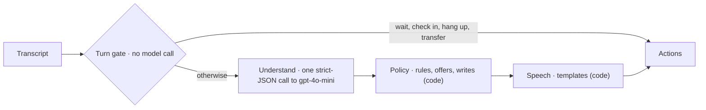

# Pirtis on Wheels kata

> **Reviewing our solution?** It is in Python: skip to
> [Our solution](#our-solution-the-python-receptionist) and its
> [main technical features](#main-technical-features).

A take-home for AI engineers: build the phone receptionist for a mobile sauna rental. One task, one set of fixtures, one implementation per language.

- `fixtures/`: the test cases. Shared by every implementation.
- `go/`: the Go implementation. Start with [go/README.md](go/README.md).
- `ts/`: the TypeScript implementation. Start with [ts/README.md](ts/README.md).
- `rust/`: the Rust implementation. Start with [rust/README.md](rust/README.md).
- `python/`: the Python implementation. Start with [python/README.md](python/README.md).

Pick one language. The fixtures, the rules and the harness are the same in every language.

The design notes and grading material live outside this directory and are not part of what the candidate receives.

---

# Our solution: the Python receptionist

**The model listens, code talks.** Each turn:
- a turn gate settles waiting, silence and requests for a person with no model call
- one strict-JSON call to gpt-4o-mini records what the caller said, checked against
  their own words
- a deterministic policy applies every rule and makes every write, after a pre-flight
  that mirrors the API's own checks
- the reply is rendered by code, with numbers and dates as words

The agent is `python/pirtis/agent/` (`decide()` in `agent.py`), and nothing else of
the kit's was changed.



**Where it stands** (agent `bd98c5cf8006`):
- **The frozen gate passes:** 46/46 cases, 138/138 runs, the kit's judge included. That
  is the kit's 14 cases plus 32 of ours: edge cases, hidden-style cases, red-team
  attacks, and cases promoted from real calls.
- **The extractor eval:** 41/41 fixtures heard right in all 3 runs; every field 100%.
- **Cost and speed:** 0 or 1 model calls a turn, about $0.0004 a turn; p95 2.15 s.
- **The naive starter** passed 4 of the 14 given cases.

The graphs are in [docs/evaluation.md](docs/evaluation.md); how each number is computed
is in [docs/data-science.md](docs/data-science.md).

## Main technical features

**The agent** (`python/pirtis/agent/`)
- **A turn gate with no model call:** waits while the caller is still speaking, checks
  in on a silence and then hangs up, hands off when the caller asks for a person or
  cuts in angrily. 15 of 138 gate runs need no model at all.
- **One strict-JSON extraction a turn** into a validated `CallState`. The schema puts
  the caller's quote before each value, and code checks every quote against the
  caller's own words before a tow figure, a sauna or a "yes" counts.
- **A deterministic policy:** a mirror of the API's own rules (capacity, tow weight,
  power, weekend minimum, turnaround, overlaps) runs before every write, so an offer is
  always bookable; an offer engine picks and explains the sauna; moves, cancels and a
  retry on a lost slot.
- **Speech rendered by code:** short sentences, one question at a time, numbers and
  dates as words, enforced in the `say` handler.
- **Safety:** identification before any customer data, no other customer's details,
  prompt injection and price demands void consent, off-topic requests steered back.

**Evaluation and data science** ([docs/data-science.md](docs/data-science.md))
- **A frozen gate:** pass^3 = 1.0 on every case, judge included, reported split into
  deterministic and judge verdicts, with cost and latency.
- **An extractor eval:** 41 gold call states, field-by-field accuracy, so "misheard" is
  told apart from "decided wrong" and "misjudged".
- **A reliability curve:** an unbiased pass^k estimate for k = 1..5, which found a 1-in-5
  flake that two passing gates had missed.
- **Metamorphic variants:** persona, date-shift, speech-noise and tow transforms of the
  given cases, kept only when the kit's own API agrees on the answer (59 of 64).
- **Red-team and hidden-style cases** of our own, beside the kit's 14.
- **Human evaluation and judge calibration:** scenario cards, a five-item rubric, and
  Cohen's κ between the judge and people (built; not yet run).

**Operations** (`python/pirtis/ops/`, `python/pirtis/playground/`)
- **A caller simulator:** speak or type, a live booking card showing the words each fact
  came from, test controls (anger, barge-in, silence), fixture replay.
- **An admin console:** the gate's thermal view by agent version, the booking funnel,
  intent-mix drift (PSI), a latency ECDF, cost, a per-turn trace with the model's
  evidence, a fleet calendar with a "what if", and the human-eval results.
- **Privacy-safe telemetry:** one `TurnRecord` per turn with no text and no names, the
  phone only as a salted hash; OpenTelemetry GenAI attributes.
- **An improvement loop:** a 👎 on a reply becomes a fixture through a person's review,
  then a red run, a fix, and the full gate.
- **A versioned data layer:** six record types, a privacy class on every field,
  retention per type, atomic one-file-per-record storage.

**Deployment** ([deploy/README.md](deploy/README.md))
- **One image, two workloads** on Azure Container Apps in the EU: the app (scales to
  zero) and a nightly gate job.
- **The deploy is gated:** it refuses an agent version without a passing gate.
- **Sign-in, rate limits and a daily spending cap;** secrets never in the image or in
  git.
- **Three alerts:** a gate regression, agent errors, slow turns.
- **Infrastructure as code:** Terraform, one `make` command per step.

## Where things are

| Path | What it holds |
|---|---|
| `python/pirtis/agent/` | the receptionist: turn gate, understanding, policy, rules mirror, speech, telemetry, gold call states |
| `python/pirtis/ops/` | the gate report, gate job, extractor eval, reliability curve, variants, calibration, data model and store |
| `python/pirtis/playground/` | the caller simulator, admin console, analytics, sign-in, promotion of calls to fixtures |
| `python/pirtis/{api,llm,harness,cmd,transcript}/` | the kit's own parts, unchanged |
| `fixtures/` | the kit's 14 cases; `extra/` our 32; `variants-candidates/` 59 awaiting review |
| `tests/human/` | the human evaluation's scenario cards and protocol |
| `deploy/` | Dockerfile, Terraform, saved monitoring queries, the deploy Makefile |
| `docs/`, `reports/` | the documents below, and the raw output behind every number |
| `go/`, `ts/`, `rust/` | the kit's starters in other languages, untouched |

**Try it:**
- **The live app:** [docs/using-the-app.md](docs/using-the-app.md) has the link, how to
  sign in, and what to try.
- **Locally:**

  ```bash
  cd python && uv sync && cp .env.example .env
  ```

  Put your OpenAI key in `python/.env`, then:

  ```bash
  make check
  ```

  ```bash
  make gate
  ```

  ```bash
  make playground
  ```

  `make check` runs lint, strict types and the tests, with no model calls. `make gate`
  is the frozen gate: every case, 3 runs, all 3 must pass. `make playground` opens the
  caller simulator on <http://127.0.0.1:8000> and the admin console at `/admin`.
- **The kit's own harness** works unchanged: `cd python && uv run harness`.

**The model:** gpt-4o-mini, through OpenAI by default. To keep calls in the EU, set
`LLM_BASE_URL` to an Azure OpenAI v1 endpoint with a deployment named `gpt-4o-mini`
(SPEC §8).

**Deployed** privately on Azure (Germany West Central): the app behind a sign-in, a
nightly gate job, and three alerts. One `make` command per step; see
[deploy/README.md](deploy/README.md).

| Document | What it holds |
|---|---|
| [SPEC.md](SPEC.md) | the design: constraints, architecture, rules and where each is enforced, voice UX, the frozen gate and every result, the data model, monitoring, the improvement loop, known limits, and the decision and change logs |
| [docs/architecture/](docs/architecture/) | the diagrams of record: containers, data flow (personal data, trust boundaries, every crossing), the two critical sequences, deployment |
| [docs/evaluation.md](docs/evaluation.md) | the results as graphs and tables: reliability, the extractor, the baseline against ours, cost and latency |
| [docs/data-science.md](docs/data-science.md) | the methods behind the results: every metric's definition and code, the gate's statistical power, pass^k, the extractor eval, metamorphic variants, judge calibration, drift, telemetry, and the limits of the numbers |
| [tests/human/README.md](tests/human/README.md) | the human evaluation's protocol and rubric |
| [docs/using-the-app.md](docs/using-the-app.md) | the live app: the link, signing in, a tour |
| [BUILD_LOG.md](BUILD_LOG.md) | phase by phase: what was built, what failed and why, every decision |
| [reports/](reports/) | the raw output behind every number |
| [docs/pdf/](docs/pdf/) | the same documents as PDFs, diagrams drawn: readme, using the app, architecture, evaluation, data science, spec, deploy, build log. Rebuilt with `python3 docs/tools/make_pdfs.py` after an edit |
