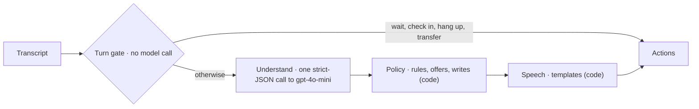

# Pirtis on Wheels kata

A take-home for AI engineers: build the phone receptionist for a mobile sauna rental. One task, one set of fixtures, one implementation per language.

- `fixtures/`: the test cases. Shared by every implementation.
- `go/`: the Go implementation. Start with [go/README.md](go/README.md).
- `ts/`: the TypeScript implementation. Start with [ts/README.md](ts/README.md).
- `rust/`: the Rust implementation. Start with [rust/README.md](rust/README.md).
- `python/`: the Python implementation. Start with [python/README.md](python/README.md).

Pick one language. The fixtures, the rules and the harness are the same in every language.

The design notes and grading material live outside this directory and are not part of what the candidate receives.

---

# Our solution: the Python receptionist

**The model listens, code talks.** Each turn:
- a turn gate settles waiting, silence and requests for a person with no model call
- one strict-JSON call to gpt-4o-mini records what the caller said, checked against
  their own words
- a deterministic policy applies every rule and makes every write, after a pre-flight
  that mirrors the API's own checks
- the reply is rendered by code, with numbers and dates as words

The agent is `python/pirtis/agent/` (`decide()` in `agent.py`), and nothing else of
the kit's was changed.



**Where it stands** (agent `bd98c5cf8006`):
- **The frozen gate passes:** 46/46 cases, 138/138 runs, the kit's judge included. That
  is the kit's 14 cases plus 32 of ours: edge cases, hidden-style cases, red-team
  attacks, and cases promoted from real calls.
- **The extractor eval:** 41/41 fixtures heard right in all 3 runs; every field 100%.
- **Cost and speed:** 0 or 1 model calls a turn, about $0.0004 a turn; p95 2.15 s.
- **The naive starter** passed 4 of the 14 given cases.

The graphs are in [docs/evaluation.md](docs/evaluation.md).

**Try it:**
- **The live app:** [docs/using-the-app.md](docs/using-the-app.md) has the link, how to
  sign in, and what to try.
- **Locally:**

  ```bash
  cd python && uv sync && cp .env.example .env
  ```

  Put your OpenAI key in `python/.env`, then:

  ```bash
  make check
  ```

  ```bash
  make gate
  ```

  ```bash
  make playground
  ```

  `make check` runs lint, strict types and the tests, with no model calls. `make gate`
  is the frozen gate: every case, 3 runs, all 3 must pass. `make playground` opens the
  caller simulator on <http://127.0.0.1:8000> and the admin console at `/admin`.
- **The kit's own harness** works unchanged: `cd python && uv run harness`.

**The model:** gpt-4o-mini, through OpenAI by default. To keep calls in the EU, set
`LLM_BASE_URL` to an Azure OpenAI v1 endpoint with a deployment named `gpt-4o-mini`
(SPEC §8).

**Deployed** privately on Azure (Germany West Central): the app behind a sign-in, a
nightly gate job, and three alerts. One `make` command per step; see
[deploy/README.md](deploy/README.md).

| Document | What it holds |
|---|---|
| [SPEC.md](SPEC.md) | the design: constraints, architecture, rules and where each is enforced, voice UX, the frozen gate and every result, the data model, monitoring, the improvement loop, known limits, and the decision and change logs |
| [docs/architecture/](docs/architecture/) | the diagrams of record: containers, data flow (personal data, trust boundaries, every crossing), the two critical sequences, deployment |
| [docs/evaluation.md](docs/evaluation.md) | the results as graphs and tables: reliability, the extractor, the baseline against ours, cost and latency |
| [docs/using-the-app.md](docs/using-the-app.md) | the live app: the link, signing in, a tour |
| [BUILD_LOG.md](BUILD_LOG.md) | phase by phase: what was built, what failed and why, every decision |
| [reports/](reports/) | the raw output behind every number |
| [docs/pdf/](docs/pdf/) | the same documents as PDFs, diagrams drawn: readme, using the app, architecture, evaluation, spec, deploy, build log. Rebuilt with `python3 docs/tools/make_pdfs.py` after an edit |
