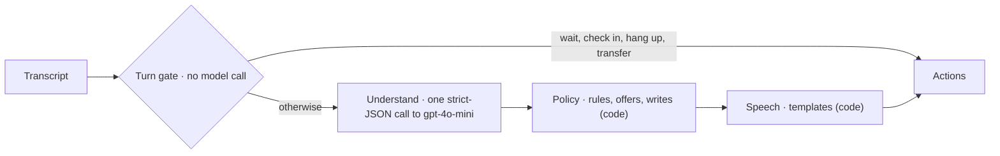

# Pirtis on Wheels kata

> **Reviewing our solution?** It is in Python: skip to
> [Our solution](#our-solution-the-python-receptionist) and its
> [core technical decisions](#core-technical-decisions). How it meets the brief, point by
> point: [docs/against-the-brief.md](docs/against-the-brief.md).

A take-home for AI engineers: build the phone receptionist for a mobile sauna rental. One task, one set of fixtures, one implementation per language.

- `fixtures/`: the test cases. Shared by every implementation.
- `go/`: the Go implementation. Start with [go/README.md](go/README.md).
- `ts/`: the TypeScript implementation. Start with [ts/README.md](ts/README.md).
- `rust/`: the Rust implementation. Start with [rust/README.md](rust/README.md).
- `python/`: the Python implementation. Start with [python/README.md](python/README.md).

Pick one language. The fixtures, the rules and the harness are the same in every language.

The design notes and grading material live outside this directory and are not part of what the candidate receives.

---

# Our solution: the Python receptionist

**The model listens, code talks.** Each turn:
- a turn gate settles waiting, silence and requests for a person with no model call
- one strict-JSON call to gpt-4o-mini records what the caller said, checked against
  their own words
- a deterministic policy applies every rule and makes every write, after a pre-flight
  that mirrors the API's own checks
- the reply is rendered by code, with numbers and dates as words

The agent is `python/pirtis/agent/` (`decide()` in `agent.py`), and nothing else of
the kit's was changed.



**Where it stands** (agent `bd98c5cf8006`):
- **The frozen gate passes:** 46/46 cases, 138/138 runs, the kit's judge included. That
  is the kit's 14 cases plus 32 of ours: edge cases, hidden-style cases, red-team
  attacks, and cases promoted from real calls.
- **The extractor eval:** 41/41 fixtures heard right in all 3 runs; every field 100%.
- **Cost and speed:** 0 or 1 model calls a turn, about $0.0004 a turn; p95 2.15 s.
- **The naive starter** passed 4 of the 14 given cases.

**Since then** (agent `8612d72cfa25`, not yet through the gate):
- **A leak closed (D-88):** the prompt's examples quoted test cases word for word: the
  kit's `turnaround` case and our case 30. They were rewritten, and a test now fails if
  the prompt shares a four-word run with any test case.
- **What it uncovered, fixed in code:**
  - the gate on `09302402ead3` failed 45/46: without its own words in the prompt, case
    30's price question got the whole price list, not Vidutinė's. Code now reads a price
    question for its sauna (D-91); case 30 then passed 3/3 in the extractor eval.
  - that eval (`6c6118d087e8`, 40/41) caught a heater preference the caller never stated,
    taken from our own cut-off offer. A heater preference now needs a caller who talked
    about heating (D-92).

  `turnaround`, whose words were the main leak, passed throughout.
- **Manual testing** on the live app (`reports/manual/2026-11-01-GS.md`, 24 of 34 passed)
  led to four agent changes: a group no sauna seats is told so before the name is asked
  (D-93); a name an English recogniser spells the English way ("Thomas") is tried once
  more the Lithuanian way (D-94); a price reading needs a price word (D-95); and the tow
  question is one question (D-96). The simulator now treats real quiet as silence, puts
  👍/👎 under each reply, and listens for names in Lithuanian.

  Agent `1c0de71d1184`, with those fixes, passed the gate to deploy and scored 58/59 on
  the held-out run.
- **The thread of the call** (`14e773f54eac`, from the second manual session,
  `reports/manual/2026-11-01-GS-2.md`: 20 of 23 passed, all three failures this): the
  transcript stays the only memory, and the agent now also reads its own last line. A
  finished task asks "anything else?" and a "no, that's all" closes the call; "yes, I'm
  here" after a check-in brings back the last question; a refusal isn't repeated word for
  word; "book it" to an offer read back is a yes; "which dates are free?" gets the coming
  weekends (D-98, D-99). See [how the receptionist remembers](docs/architecture/logic-flow.md#how-the-receptionist-remembers).
- **What's free, asked more precisely** (`b41246127e7b`): "what's free in November?" gets that
  month's weekends, and "when is the big one free?" gets that sauna's weekends, free and
  booked; both together work too (D-100). The month is read from the caller's words in
  code, the sauna from the model's checked reading; the answer reads only availability.
- **A stray word beside the name** (`8a7e195494af`): the Lithuanian name recogniser heard "my name
  is Jonas Jonaitis" as "manitis Jonas jonaitis", and the extra word hid the caller. A name
  that isn't found is tried again two words at a time, still against the calling number,
  so a stranger is still put through (D-101).
- **Closed sets typed as such** (`8612d72cfa25`): what a decision can name (the question asked,
  the queue, why nothing fits, why another sauna was offered) is a `Literal` type, and a
  test checks that speech has a line for every value. It found a test passing on a
  misspelt reason that fell through to a default line. No reply changed.

  Until the gate passes again, the measured numbers above belong to earlier agents.
- **Measured honestly:** the 46 cases are the development set, so 46/46 is a development
  score. The 59 generated variants are kept as a held-out set (D-89). Heard right, the
  agent passes all 59 and decides each as its source did, and a thousand generated calls
  keep every promise of the brief, both at zero tokens (D-97). **The live held-out run:
  58/59** (every decision right; one reply graded down by the judge), recorded as it came.

The graphs are in [docs/evaluation.md](docs/evaluation.md); how each number is computed
is in [docs/data-science.md](docs/data-science.md).

## Core technical decisions

Each decision below gives what was decided, why, and the measurement that settled it.
`D-nn` points to the [decision log](SPEC.md#13-decision-log), which also lists the
options rejected.

### AI engineering

**1. The model listens, code talks** (D-02, D-08, D-17)
- The model's only job is to record what the caller said. Code applies every rule,
  makes every API write and writes every reply.
- *Why:* a small model invents numbers and "helpfully" applies rules. A model that can
  write to the API can break a rule; one that only extracts facts can't.
- *Evidence:* the kit's starter is a tool loop, where the model calls the API itself. It
  passed 4/14, then 3/14, with 422s from the API. This design passes 46/46 every run,
  at 0 or 1 model calls a turn and about $0.0004 a turn.

**2. Timing is settled before the model is called** (D-04, D-05, D-06)
- A turn gate in code decides whether to wait for unfinished speech, check in on a
  silence, hang up, or hand off to a person.
- *Why:* on the phone, a model call is heard as silence. Turn-taking needs to be
  instant and the same every time.
- *Evidence:* 15 of 138 gate runs make no model call and take 0 ms. A request for a
  person is matched by a strict pattern, not a keyword: a bare "person" also appears in
  "the eight person one".

**3. The schema is the reasoning scaffold** (D-33, D-49, D-69)
- One strict-JSON call, with the schema generated from a pydantic class. Field order
  is the order the model writes: a gist first, each caller quote before the value taken
  from it, consent last.
- *Why:* the model commits to the caller's words before it commits to a number.
- *Evidence:* "the wood smoke sets off my asthma" was read as a wish for wood. Rewording
  the prompt didn't fix it; putting `heater_reason` before `heater_pref` did (extractor
  22/23 → 23/23).

**4. Model output is checked in code, not by more prompt** (D-54, D-75, D-78, D-79)
- A tow figure, a sauna and a "yes" count only when their quote appears in the caller's
  own lines. Hedges are settled in code. A name the caller asks about is not their own.
- *Why:* at temperature 0, each prompt rewording shifted something else. That happened
  three times in two phases.
- *Evidence:* more prompt rules made consent worse (80%). Quote checks in code took the
  extractor from 12/20 to **20/20**, and every field to 100%.

**5. An offer is bookable by construction** (D-31, D-10, D-52)
- `violations()` mirrors every API write rule and runs before every offer and every
  write. It is property-tested against the real API with hundreds of random bookings
  and moves.
- A booking is made only when what the caller heard, parsed from our own read-back,
  equals the booking we would make.
- *Why:* a 422 means the receptionist offered something it couldn't deliver, and a
  "yes" has to be a yes to what was said.
- *Evidence:* every full gate has passed the kit's check that no API call fails,
  except where a case makes one fail on purpose.

**6. Under doubt, choose the safe reading** (D-08, D-12, D-19)
- A hedged group size counts as the higher number; a hedged towing figure as the lower.
  An unclear answer means asking again. Two misunderstandings in a row hand the call to
  a person. `decide` never raises.
- *Why:* a wrong guess should cost one more question, never a booking that breaks a
  rule.
- *Evidence:* case 62, "eight of us, maybe nine", failed 1 run in 5 before D-79. The
  four cases with a hedged number then passed 20/20.

**7. Safety is policy, not prompt** (D-07, D-11, D-45, D-73, D-74)
- No customer data is read before the caller is identified, and no other customer's
  details are ever given.
- A "yes" that names its own price, or that talks to the system ("ignore your
  instructions"), is void.
- A request for our instructions gets a fixed line, so the prompt can't leak.
- *Evidence:* 7 red-team cases, held at 1.0. The first red-team run caught a booking
  made after a prompt injection; it is fixed in code.

### Data science and evaluation

**8. Reliability means every run passes** (D-21)
- The gate: every case passes **3 of 3** runs (pass^3 = 1.0, not pass@k), with the
  kit's judge included. The gate was frozen before the agent was written and never
  lowered, and a failing gate blocks a deploy (D-85).
- Every verdict is split into the checks done in code and the judge's.
- *Evidence:* 138 runs with no failure puts a 95% upper bound of about 2.1% on the
  failure rate per run.

**9. Separate "misheard" from "decided wrong" and "misjudged"** (D-36, D-55, D-70)
- Every fixture the model sees has a gold call state: 41 of them. The extractor eval
  runs the real extraction 3 times per fixture and compares field by field.
- *Why:* an end-to-end failure doesn't say which part failed.
- *Evidence:* it caught the asthma regression before the gate did, and a red-team case
  that recorded an asked-about name as the caller's (D-78).

**10. Measure what the gate can't see** (D-79)
- Every case also runs 5 times, giving an unbiased pass^k for k = 1 to 5, the estimator
  τ-bench uses: C(c, k) / C(n, k).
- *Why:* a case that fails 1 run in 5 gets through a 3-of-3 gate about half the time.
- *Evidence:* it found a case that had passed two gates, but whose estimated chance of
  failing a 3-of-3 gate was 60%. That case was fixed in code.

**11. Generated tests need an oracle that isn't our code** (D-44, D-76)
- Metamorphic variants of the given cases: another caller, a calendar shift, speech-to-
  text noise, another tow figure. A variant is kept only when the **kit's own API**
  agrees on the answer.
- *Why:* the hidden cases are "the same rules, other callers, cars and dates", and a
  test checked by the policy it tests proves nothing.
- They are the **held-out set**: never used to change the agent, scored once by
  `make heldout`, by transform, before anything is tuned on them (D-89).
- *Evidence:* 64 generated, 59 kept. 5 were dropped because a shift changed which
  saunas fit.

**12. The judge is a model too: read it, calibrate it, never rerun it** (D-47, D-51, D-72, D-77, D-87)
- Every judge failure is read before anything changes, and a gate is never rerun until
  it passes.
- The judge's blind spots were found and designed around: it flips negated statements,
  reads "or" as "and", and isn't told today's date.
- Its agreement with people is measured with Cohen's κ, on human ratings collected
  with scenario cards.
- *Evidence:* a 1-in-43 judge flip on a correct reply was fixed by wording the reply
  more plainly (20/20). The calibration is built, but not run yet: there are no human
  ratings so far.

**13. Production data is telemetry without content, and it feeds back as tests** (D-26, D-30, D-43, D-56, D-60)
- One `TurnRecord` per turn: no text, no names, the phone only as a salted hash.
- Intent-mix drift is watched with the PSI.
- A 👎 on a reply becomes a fixture, but only after a person reviews it.
- A second model re-reads calls **off the call path** and queues every turn it hears
  differently, with both readings, for a person (`make review`, D-90).
- `agent_version` is a hash of the agent's source code, so every number traces to the
  code that produced it.
- *Evidence:* cases 60–62 came from simulator calls through this loop, and case 62
  exposed the hedge flake in decision 10.

How each metric is computed, and how far to trust it: [docs/data-science.md](docs/data-science.md).

## What else was built

- **Caller simulator:** speak or type, a booking card that shows the words each fact
  came from, test controls (anger, barge-in, silence) and fixture replay.
- **Admin console:** the gate's thermal view by agent version, with the kit's cases kept
  apart from ours; the booking funnel, intent drift, a latency ECDF, cost, per-turn
  traces with the model's evidence, a fleet calendar with a "what if", and the human
  evaluation.
- **Data layer:** six versioned record types, a privacy class on every field, retention
  per type, and atomic one-file-per-record storage.
- **Azure deployment:** one image runs both the app (which scales to zero) and a nightly
  gate job. Sign-in, rate limits and a daily spending cap, three alerts, and Terraform
  with one `make` command per step ([deploy/README.md](deploy/README.md)).

## Where things are

| Path | What it holds |
|---|---|
| `python/pirtis/agent/` | the receptionist: turn gate, understanding, policy, rules mirror, speech, telemetry, gold call states |
| `python/pirtis/ops/` | the gate report, gate job, extractor eval, reliability curve, variants, calibration, data model and store |
| `python/pirtis/playground/` | the caller simulator, admin console, analytics, sign-in, promotion of calls to fixtures |
| `python/pirtis/{api,llm,harness,cmd,transcript}/` | the kit's own parts, unchanged |
| `fixtures/` | the kit's 14 cases; `extra/` our 32; `variants-candidates/` the 59 generated ones, kept as the held-out set. Every case, where it comes from and what it tests: [docs/fixtures.md](docs/fixtures.md) |
| `tests/human/` | the human evaluation's scenario cards and protocol |
| `deploy/` | Dockerfile, Terraform, saved monitoring queries, the deploy Makefile |
| `docs/`, `reports/` | the documents below, and the raw output behind every number |
| `go/`, `ts/`, `rust/` | the kit's starters in other languages, untouched |

**Try it:**
- **The live app:** [docs/using-the-app.md](docs/using-the-app.md) has the link and
  sign-in; then the [tester guide](docs/guide-caller.md) or the
  [admin guide](docs/guide-admin.md).
- **Locally:**

  ```bash
  cd python && uv sync && cp .env.example .env
  ```

  Put your OpenAI key in `python/.env`, then:

  ```bash
  make check
  ```

  ```bash
  make gate
  ```

  ```bash
  make playground
  ```

  `make check` runs lint, strict types and the tests, with no model calls. `make gate`
  is the frozen gate: every case, 3 runs, all 3 must pass. `make playground` opens the
  caller simulator on <http://127.0.0.1:8000> and the admin console at `/admin`.
- **The kit's own harness** works unchanged: `cd python && uv run harness`.
- **Measuring more:** `make eval-extract` (the model's understanding against gold),
  `make heldout` (the held-out score), `make review` (a second model re-reads recent
  calls). What each costs is in [docs/data-science.md](docs/data-science.md#13-reproduce).

**The model:** gpt-4o-mini, through OpenAI by default. To keep calls in the EU, set
`LLM_BASE_URL` to an Azure OpenAI v1 endpoint with a deployment named `gpt-4o-mini`
(SPEC §8).

**Deployed** privately on Azure (Germany West Central): the app behind a sign-in, a
nightly gate job, and three alerts. One `make` command per step; see
[deploy/README.md](deploy/README.md).

| Document | What it holds |
|---|---|
| [docs/against-the-brief.md](docs/against-the-brief.md) | the take-home's brief, requirement by requirement: a verdict and the evidence for each, the open risks, and what to do before submitting |
| [docs/walkthrough.md](docs/walkthrough.md) | the agent file by file, in the order a turn runs through it: what each file does, and the questions a reviewer is likely to ask with the short answer to each |
| [SPEC.md](SPEC.md) | the design: constraints, architecture, rules and where each is enforced, voice UX, the frozen gate and every result, the data model, monitoring, the improvement loop, known limits, and the decision and change logs |
| [docs/architecture/](docs/architecture/) | the diagrams of record: containers, data flow (personal data, trust boundaries, every crossing), the two critical sequences, deployment, and the [logic flow](docs/architecture/logic-flow.md): what the receptionist decides on a turn, in what order, and where the model's judgement ends |
| [docs/evaluation.md](docs/evaluation.md) | the results as graphs and tables: reliability, the extractor, the baseline against ours, cost and latency |
| [docs/data-science.md](docs/data-science.md) | the methods behind the results: every metric's definition and code, the gate's statistical power, development and held-out sets, pass^k, the extractor eval, metamorphic variants, judge calibration, drift, telemetry, the feedback loop, and the limits of the numbers |
| [tests/human/README.md](tests/human/README.md) | the human evaluation's protocol and rubric |
| [docs/using-the-app.md](docs/using-the-app.md) | the live app: the link, signing in, and which guide is yours |
| [docs/guide-caller.md](docs/guide-caller.md) | for testers: making calls, what to try, the test controls, scenario cards and rating |
| [docs/guide-admin.md](docs/guide-admin.md) | for reviewers and the owner: every admin view and how to act on it, turning feedback into test cases, owner commands |
| [BUILD_LOG.md](BUILD_LOG.md) | phase by phase: what was built, what failed and why, every decision |
| [reports/](reports/) | the raw output behind every number |
| [docs/fixtures.md](docs/fixtures.md) | every test case: what a case holds, the world they share, where each group comes from, what each case tests, the generated variants |
| [docs/pdf/](docs/pdf/) | every document here as a PDF, diagrams drawn, the guides each on their own for handing out. Rebuilt with `python3 docs/tools/make_pdfs.py` after an edit; a test fails when a PDF is older than its document |
