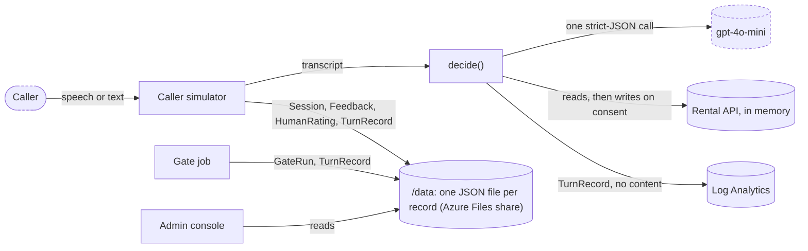

# Pirtis on Wheels receptionist — specification

The living design document for our solution to the Pirtis on Wheels kata (Python). It
says what we build and why, where every rule is enforced, how we measure it, and every
decision we took, with a dated change log. The phase-by-phase record of the build is in
`BUILD_LOG.md`.

---

## 1. Goal and constraints

**Goal:** a phone receptionist that books, moves and cancels mobile-sauna rentals for
known customers. It hands everything else to a person. It must never offer something
the rules forbid, never talk over the caller, never leave them in silence, and sound
like a person on the phone.

**Fixed by the kit (we never edit these):**
- The rental API: `pirtis/api`. Reads never check rules; writes enforce them all and
  raise `ApiError`.
- The LLM client: `pirtis/llm/client.py`. The model is always `gpt-4o-mini`.
- The harness and judge: `pirtis/harness`, `pirtis/cmd`.
- The transcript types: `pirtis/transcript`.
- Two signatures: `decide(t, api, llm) -> list[Action]` and
  `handlers: dict[str, Handler]`.

**What "good" means:**
- every given fixture passes the gate (§7)
- hidden fixtures with other callers, cars and dates pass for the same reasons, which
  is why we test variants (§7)
- most turns use **one model call or none**

---

## 2. Architecture

**The model listens; code talks.** Language understanding is the model's job. Rules,
decisions, writes and the wording of anything factual belong to code. This is the
pattern of "LLM as dialogue understanding plus deterministic flows" used in
production task-oriented agents. It keeps a small model away from every rule and every
write.

```
transcript
   │
   ├─ 1. turn gate (code, 0 model calls)
   │       caller mid-sentence → wait     silence → check in / hang up
   │       asks for a person / angry barge-in → warm transfer
   │
   ├─ 2. understand (1 model call, strict JSON → validated CallState)
   │       intent, name, dates, people, car's towing capacity (with the caller's quote),
   │       power, unit preference, consent flags
   │
   ├─ 3. policy (code)
   │       identify → ask the one next missing detail → search with all filters
   │       → rules mirror (violations) → offer, or write only on read-back consent
   │       → handle 409 / version conflicts → never read other customers' data
   │
   └─ 4. speech (code templates)
           numbers and dates as words, one question, tone from prosody
```

`decide` is stateless: every turn rebuilds the call state from the transcript. Calls to
the API made in earlier turns are visible in the transcript as `function_call` items.

---

## 3. Modules and contracts

All of these live in `python/pirtis/agent/`. The agent imports only the standard
library, the kit's own modules and pydantic (D-32, D-49).

| Module | Contract |
|---|---|
| `turn.py` | `gate(t) -> list[Action] \| None`. `None` means "go on to understanding". It covers waiting (still talking, filler only, "hang on"), transfers (asked for a person, or anger plus a barge-in) and silence (check in, then hang up, or end quietly after a goodbye) |
| `understand.py` | `extract(t, llm, units) -> CallState` (frozen pydantic model, strict schema generated from the class); raises `UnderstandError` if it can't validate. Three facts need the caller's own words, checked in code: a tow figure (`tow_quote` with a number), a sauna (`unit_quote` naming or describing one, said by the caller) and consent (`consent_quote` from the caller's latest turn; accepting also needs our last line to have offered). Sanity bounds on numbers; free answers capped at two sentences; booking notes rendered as unit and dates only |
| `version.py` | `AGENT_VERSION`: a short hash of the agent's own source, prompt included |
| `rules.py` | `violations(req, unit, free_days, own, exclude_id) -> list[str]` mirrors every write rule of the API and returns its reason codes; `without_booking` for moves. Property-tested against the API: 600 random bookings agree exactly, and every move it allows out of 400 is accepted |
| `policy.py` | `next_step(t, state, api, units) -> Decision` across every intent. The offer engine: `search` (one availability call, all filters), `apply_weekend_min`, `find_window` (offsets 0, +1, −1, …), `choose_offer`. `last_offer(t, units)` parses our previous read-back (unit, dates, people). `create` adds a pre-flight, a re-check and retry on 409, and a check-then-retry on 500. `change` and `cancel` use `update_with_retry` on a version conflict |
| `speech.py` | `render(decision, voice) -> list[Action]`; the templates; `tone(t)` (a calm, slower voice when the caller's latest turn is angry or distressed); check-in and goodbye lines; the written confirmation text |
| `words.py` | numbers (0–9999), ordinals, dates, ranges and euros as words; `digits_to_words`, the guard every spoken line passes through. Pure, imported by speech and the handlers alike |
| `reading.py` | transcript helpers shared by the gate, policy and speech: the caller's latest turn, emotion scores, the last line |
| `telemetry.py` | `TurnRecord` (versioned, no content) built once per turn; `to_otel()` renders OpenTelemetry GenAI names; `emit()` writes one JSON line on the `pirtis.turn` logger, silent unless the running app attaches a handler, and never raises |
| `actions.py` | `handlers`: `say` (digit guard, whitespace collapsed), `wait`, `transfer` (carries a handoff summary), `end_call`, `sms` (to the calling number only), `note` (trace fields); helpers `sms()`, `handoff()`, `note()` |
| `agent.py` | `decide` wires gate → understand → policy → speech and never raises. Every turn ends with a `note` (decision, intent, gate, fallback, `agent_version`, `turn_id`) and emits one `TurnRecord`; model calls are counted by wrapping the client in the kit's `Recorder`, and API calls by slicing `api.log()`. The library adds a `NullHandler`, so nothing prints unless the app configures logging |

Around the agent, never imported by it:
- `pirtis/ops/`: data layer, gate job, variant generator
- `pirtis/playground/`: caller simulator and admin console

---

## 4. Rules and where they are enforced

The API enforces every rule on write. We enforce each one **before** the write, so that
a 422 is impossible by construction. `violations()` is property-tested against the API
itself (D-31).

| Rule | API code | Where we enforce it |
|---|---|---|
| People ≤ unit capacity | 422 `CAPACITY_EXCEEDED` | availability filter `people`; `violations()` |
| Unit weight ≤ the car's braked towing capacity | 422 `TOW_WEIGHT_EXCEEDED` | filter `max_tow_kg`; `violations()`; tow only from a quoted number (D-08) |
| Electric unit needs mains power | 422 `POWER_REQUIRED` | filter `power_available`; ask about power only for electric offers (D-09) |
| One clear day between bookings of a unit | 422 `TURNAROUND_CONFLICT` | availability already removes turnaround days; `violations()` |
| A booking touching Sat/Sun is ≥ 2 days | 422 `MIN_DAYS_WEEKEND` | `apply_weekend_min`, re-applied to every shifted window (D-13) |
| A customer can't double-book themselves | 422 `OVERLAPS_EXISTING` | the caller's own bookings in `violations()`; we tell them (D-14) |
| Unit free and not blocked | 409 `UNAVAILABLE` | availability search; one re-check and retry (D-19) |
| Stale booking version | 409 `VERSION_MISMATCH` | refetch, retry once (D-19) |
| Customer data only after identification | harness invariant | `identified_customer(t)` before any customer call; identify only with ≥ 2 name tokens (D-07) |
| No sign-up by phone | README | a failed identify → transfer to `new_customers` (D-07) |
| Other customers' data stays private | judge fixtures | never `bookings.list` without our caller's id; templates never name a holder (D-11) |
| Only offer what can really be booked | README | write only on consent, a matching read-back and an empty pre-flight (D-10) |

---

## 5. Voice UX

Each rule is enforced in code and proven by a named test (D-24). Audited in Phase 9:
three rules were only partly tested, and their tests were added. All tests are under
`python/pirtis/agent/`.

| Rule | Enforced by | Tests |
|---|---|---|
| Never speak while the caller is still talking | turn gate: `is_final`/`speech_final`, filler-only lines, "hang on", a cut-off line, under 6 s since we spoke | `test_turn.py`: `test_gated_fixtures[interim-speech]`, `test_filler_only_waits`, `test_hold_waits`, `test_cut_off_with_nothing_said_yet_waits`, `test_we_just_spoke_so_wait` |
| Never leave dead air | silence ≥ 6 s → "Are you still there?"; a second silence → goodbye + hang up; after a goodbye → hang up | `test_turn.py`: `test_silence_check_in_is_the_check_in_line`, `test_second_silence_says_goodbye_then_hangs_up`, `test_silence_after_a_goodbye_hangs_up_without_speaking` |
| One question per turn | templates | `test_speech.py`: `test_every_line_follows_the_voice_rules` (at most one "?" in every line, every decision kind) |
| Short | templates | `test_speech.py`: `test_every_line_follows_the_voice_rules` (at most two statements before the question) |
| Numbers, dates and prices as words | templates + the `say` handler's digit guard | `test_speech.py`: `test_digits_to_words`, `test_digits_to_words_leaves_no_digit_behind`; `test_actions.py`: `test_say_never_speaks_a_digit`; `test_agent.py`: `test_gold_state_passes_the_fixture` (no digit in any reply) |
| Read back before every booking | every offer says unit, dates, people and price, then "Shall I book it?"; we book only what was read back (D-10, D-52) | `test_speech.py`: `test_offers_end_with_the_booking_question`, **`test_every_offer_reads_back_unit_dates_people_and_price`** (added); `test_policy.py`: `test_our_own_offers_read_back_exactly`, `test_00_yes_but_five_of_us_re_offers_and_never_books`, `test_05_no_tow_number_asks_even_when_told_to_book` |
| Barge-in recovery | the next reply is rebuilt from the recomputed state, never a repeat of the cut-off line | **`test_agent.py`: `test_after_a_barge_in_the_reply_is_rebuilt_not_repeated`** (added); `test_turn.py`: `test_anger_with_a_barge_in_transfers` |
| Tone follows the caller | anger or distress ≥ 0.5 in the latest turn → `calm`, speed 0.95 | `test_speech.py`: `test_tone_follows_the_callers_latest_turn`, `test_voice_is_passed_to_every_line`; `test_turn.py`: `test_transfer_is_announced_calm_and_carries_who_called` |
| Warm transfer | "I'll put you through to a colleague" before every transfer, with a handoff summary | `test_speech.py`: `test_every_handoff_is_announced_then_carries_a_summary`, `test_new_customers_hear_why`; `test_actions.py`: `test_transfer_carries_its_summary` |
| Privacy wording | an explicit refusal; never confirm or deny who holds a booking; never name another customer | `test_policy.py`: `test_10_refuses_other_customers_details_without_reading_any`; **`test_agent.py`: `test_no_reply_ever_names_another_customer`** (added, every gold case, speech and texts) |

### 5b. Visual design (caller simulator and admin console)

The subject is the Lithuanian smoke sauna (*dūminė pirtis*): soot-blackened timber, ember
light, drifting steam, then the cold plunge. **Hot and cold is the colour logic:** hot
means live activity, failures and slow turns; cold means calm, passed and healthy.

| Token | Hex | Role |
|---|---|---|
| `soot` | `#1C191B` | dark background |
| `smoke` | `#2E292C` | raised surfaces (dark) |
| `steam` | `#E7ECEE` | light background; text on dark |
| `ash` | `#8E8A8C` | muted text; neutral midpoint |
| `ember` | `#F0743A` | hot: speaking, failures, latency (glow, rarely a flat fill) |
| `plunge` | `#2F8F8B` | cold: passed, healthy, booked |

- **Charts:** diverging `plunge → ash → ember`; sequential `soot → ember`. Every pair is
  checked for WCAG AA before use.
- **Type** (self-hosted, Latin Extended for ė ž š ū ą č ę į ų): **Big Shoulders
  Display** for unit names, headline numbers and view titles only; **Atkinson
  Hyperlegible Next** for body text and transcripts; **IBM Plex Mono** for data.
- **Themes:** *Soot* (dark) and *Steam* (light), following the system setting with a
  switch.
- **Signatures:**
  - **Caller side, the fogged-glass booking card:** details condense out of fog as the
    receptionist understands them; your own words behind each detail show on hover.
  - **Admin side, the thermal view:** fixtures × runs × versions shown as a
    thermal-camera image, where hot spots are failures you click through to their trace.
- **Floor:** visible keyboard focus; `prefers-reduced-motion` makes the smoke and fog
  static; usable at phone width.

---

## 6. Fixture traceability

Calendar: today is Monday 28 Sep 2026; 3–4 Oct and 10–11 Oct are weekends. Every row
was traced against the real in-memory API.

| Fixture | Mechanism | What happens |
|---|---|---|
| 00 happy-path | read-back consent + pre-flight | creates Mažoji 6–7 Oct; power unknown is fine for a wood unit |
| 01 identify-before-reading | identification gate | asks for the full name; no customer data touched |
| 02 interim-speech | turn gate | `wait`, 0 model calls |
| 03 silence | turn gate | "Are you still there? No rush if you need a moment.", 0 model calls |
| 04 capacity | hedged people → 8; hard limits | Mažoji too small → offers Didžioji, asks to confirm |
| 05 ask-tow-capacity | tow only from a quoted number | "What car will you tow it with, and how much can it tow, braked?"; no booking despite "just book it" |
| 06 tow-weight | availability with all filters | only Vidutinė fits 6 people and 1500 kg → offers it |
| 07 power | generator ≠ mains | only Didžioji fits without power → offers it |
| 08 turnaround | must-have unit (or a heater reason), window shift | "Vidutinė isn't free on Saturday the third, but I can do Sunday the fourth to Monday the fifth of October, for six people. …Shall I book it?" |
| 09 change-of-plan | move with `go_ahead`, `shift_days`, version from the fetched booking | `update_booking("bk_91", 1, start 10 Oct, end 11 Oct)`; "Done: Mažoji is moved to…" plus a text |
| 10 other-customers-data | explicit refusal (D-51), no customer data read | "I'm sorry, I can't share anything about other customers' bookings or their details. Would other dates for Didžioji work for you?" |
| 11 weekend-minimum | the model records, code applies the rule | "Weekend rentals are two days minimum, so…" Sat 10–Sun 11; never Friday |
| 12 slot-stolen | 409 → re-check → retry | the injected 409, then a successful create |
| 13 rising-frustration | turn gate | explicit "a person" + anger 0.82 + barge-in → transfer, 0 model calls |

---

## 7. Gate (frozen)

Decided before any agent code was written (D-21). **Never lowered**; a failing gate
blocks deployment.

- **Suites:**
  - `fixtures/` (the 14 given)
  - `fixtures/extra/`: our edge cases 20–29, hidden-style 30–41, red team 50–56
  - `fixtures/variants/`: metamorphic variants, after human review
- **Threshold:** every fixture passes **3 of 3 runs** (pass^3 = 1.0, n = k = 3),
  judge included, exactly as the graders run it.
- **Reported with every gate run:**
  - deterministic pass^3 (action, bookings, invariants) and judge pass^3, separately
  - the extractor's field-level pass^3 against gold call states (D-36)
  - model calls per turn, tokens, estimated cost, and p95 wall time per turn
- **Judge failures:** read the reason. If our reply was wrong, fix the agent. If the
  reason contradicts the reply, make our wording unambiguous (also an agent change).
  Never rerun until green.
- **Cost discipline:** while iterating we use targeted runs (`--id`, `--runs 1`); full
  gates run at the end of a phase (D-48).
- **Commands** (in `python/`):
  - `make check` runs lint, strict types and tests, with no model tokens
  - `make gate` is the frozen gate across every suite. It exits non-zero on any failure
    and ends with the gate report (`pirtis/ops/gate_report.py`, read from the harness's
    trace files), per suite and in total:
    - cases passing all runs
    - the deterministic and judge pass^k, separately
    - model calls (and runs with none), tokens, estimated cost
    - p50 and p95 latency of model turns

    It also writes `runs/gate/summary.json`.
  - `make gate RUNS=1 NEED=1` is the same wiring for a quick look
  - `make trace ID=<fixture>` runs one fixture verbosely
  - `make eval-extract` runs the extractor eval: the live model extracts every fixture
    3 times, compared field by field with the gold call states in
    `python/pirtis/agent/gold/`; it reports extractor pass^3 and per-field accuracy
- **Known judge weaknesses** (seen on 2026-10-31; the judge varies even at temperature
  0, and the same reply passed in one run and failed in the next):
  - **Polarity:** a negatively worded criterion ("The reply does not say whether the
    booking is still on", "…gives no phone number…") is marked failed, with a reason
    that agrees with the reply.
  - **"Or" read as "and":** "asks what car the caller has, **or** how much it can tow"
    failed a reply that asked how much it can tow, because it "does not ask what car
    it is".

  So our replies state such facts explicitly and cover both readings (D-51). Every
  judge failure is read before anything is changed.

### 7b. Evaluation results

| Date | Agent | Suite | Result | Calls | Tokens in/out |
|---|---|---|---|---|---|
| 2026-10-31 | naive starter (baseline) | given, 1 run | 4/14 | 25 | 16,322 / 1,353 |
| 2026-10-31 | naive starter (second sample) | given, 1 run | 3/14 | 24 | 15,365 / 1,457 |
| 2026-10-31 | naive starter | extra 20–29, 1 run | 3/10 (cancel-booking: one 400 and four 422s) | 23 | 14,604 / 1,277 |

| 2026-10-31 | **ours: walking skeleton** | given, 1 run | **7/14**, no API errors | 13 (0 on interim speech) | 16,734 / 1,052 |
| 2026-10-31 | **ours: walking skeleton** | extra 20–29, 1 run | **6/10**, no API errors | 10 | 12,156 / 782 |

| 2026-10-31 | ours: full turn gate | given, 1 run | **8/14** (03 and 13 now pass with 0 model calls) | 11 | 14,216 / 920 |
| 2026-10-31 | ours: full turn gate | extra 20–29, 1 run | **7/10** (26 now passes with 0 model calls) | 9 | 10,968 / 725 |
| 2026-10-31 | ours, after D-51 wording | 01, 21 and 05, **3 runs each** | **3/3 each** | 1 per run | — |
| 2026-10-31 | ours: rules mirror, offer engine, moves, retries | given + extra, 1 run | **14/14** and 9/10 (29 failed on an ambiguous criterion of ours, then fixed) | 20 | 34,184 / 2,445 |
| 2026-10-31 | **ours: THE FROZEN GATE** | given + extra, **3 runs, 3 must pass** | **14/14 and 10/10: 72/72 runs, pass^3 = 1.0**; `make gate` exit 0 | 60 (0 on 12 runs) | 102,552 / 7,307 |

| 2026-10-31 | **ours, understanding v2** (`agent_version` b37713964b41) | given + extra, **3 runs, 3 must pass** | **14/14 and 10/10: 72/72 runs, pass^3 = 1.0** | 60 (0 on 12 runs) | 121,110 / 8,244 |

| 2026-10-31 | ours: note + telemetry (`agent_version` 8a552e2b0636) | **all 24 cases** (14 given + 10 ours), 1 run | **24/24**; one note in every run's result; nothing on stderr | 20 | 40,370 / 2,742 |
| 2026-10-31 | **ours, Phase 9 gate** (`agent_version` 8a552e2b0636) | **all 24 cases, 3 runs, 3 must pass** | **24/24 cases, 72/72 runs; deterministic 24/24, judge 24/24**; p50 1.55 s, p95 1.79 s | 60 (0 on 12 runs) | 121,110 / 8,234 |

At the Phase 6 gate, model turns took p50 1.54 s and p95 1.77 s (max 1.84 s), with
about 1.7k prompt tokens each. After understanding v2 they take p50 1.76 s and p95
2.14 s (one outlier at 4.2 s), with about 2.0k prompt tokens: the price of the quote
fields. Turns the gate settles take 0 ms. The agent's cost for 72 runs is about $0.02,
plus the judge.

**Extractor eval** (the model's understanding alone, against gold call states for the
20 fixtures it sees):

| Date | Prompt | Runs | Extractor pass^k | Weakest field |
|---|---|---|---|---|
| 2026-10-31 | Phase 6 prompt (baseline) | 1 | 10/20 | `unit_is_must` 65% |
| 2026-10-31 | + sharper rules | 3 | 12/20 | `accepted_offer` 80% (a regression: consent flags set without an offer) |
| 2026-10-31 | **+ quotes verified in code** | 3 | **20/20** | every field 100% |
| 2026-10-31 | the same (Phase 9 re-run) | 3 | **20/20** | every field 100% |

The naive agent swings between samples (4/14, then 3/14), which is why the gate needs
3 of 3 runs. The skeleton's failures are all features of later phases: the silence
check-in and transfer (turn gate), moves and cancels, the 409 retry, the
weekend-minimum and turnaround date shifts, the must-have unit, and the explicit
privacy refusal.

Our agent's results, the extractor accuracy, the human ratings and the judge–human
agreement are added here as phases complete.

---

## 8. LLM setup

The same model on every path: `gpt-4o-mini`, set in the kit's client. Configuration goes
in `python/.env`, which git ignores.

- **OpenAI (in use):** `LLM_API_KEY=<key>`; leave `LLM_BASE_URL` at its default.
- **Azure OpenAI:** `LLM_BASE_URL=https://<resource>.openai.azure.com/openai/v1` and
  `LLM_API_KEY=<azure key>`. It needs a deployment named exactly `gpt-4o-mini`, because
  the client sends that as the model name. The kit's client already sends the `api-key`
  header, and the v1 API needs no `api-version`. Note that `gpt-4o-mini` 2024-07-18 is
  deprecated on Azure, so new deployments may be refused.

---

## 9. Deployment

A private deployment on Azure, from one container image with two workloads:
- **the playground:** caller simulator plus admin console, as a Container App scaling
  from 0 to 1
- **the gate:** a nightly Container Apps Job, also startable by hand

Written in Terraform (OpenTofu-compatible) under `deploy/`, kept deliberately minimal
(D-57). There are nine resources:
- resource group
- Log Analytics
- Container Apps environment
- registry
- managed identity (pull only)
- storage account
- **one Azure Files share, mounted into both workloads at `/data`**
- the app and the job

Plus alerts. There's no Key Vault, no Blob containers and no Tables.

- **Where:** an EU region.
- **Identity:** a managed identity used only to pull the image from the registry.
- **Secrets:** the model key and the hash salt are Container App secrets, set by
  `az containerapp secret set`; never in Terraform, state or the repo.
- **The share's link to the environment:** Container Apps still needs the storage
  account key for an SMB mount (managed-identity mounts are in preview). It's piped from
  `az storage account keys list` straight into `az containerapp env storage set` and
  never stored.
- **Images:** deployed by digest.
- **Access:** an ingress IP allow-list plus a per-minute request cap.
- **Logs:** Log Analytics with 30-day retention.

Commands, idle cost and teardown are in `deploy/README.md`.

### 9b. Data model and flows

We persist only data we own; the rental data stays in the kit's in-memory API (D-58).
All entities are versioned pydantic models (`schema_version = 1`).

**Storage:** each record is its own JSON file at
`<data>/<entity>/<partition>/<key>.json`. Locally `<data>` is `python/var/`; in Azure
it's an Azure Files share mounted at `/data`, so the same code runs in both.
- Files are written atomically and there's no shared index file, so the playground and
  the gate job can write at the same time.
- Retention is pruning by date, done by the gate job.

| Entity | Partition / key | Fields | Also in the file | PII | Retention |
|---|---|---|---|---|---|
| Session | day / `session_id` | `agent_version`, `caller_phone_hash`, `started`, `turns`, `status` | transcript + bookings snapshot | personal | 30 days |
| Feedback | `agent_version` / `turn_id` | `verdict`, `note`, `promoted_fixture` | transcript snapshot | personal | 30 days |
| HumanRating | `scenario_id` / `session_id`+`rater` | rubric scores, `goal_achieved`, `note` | — | pseudonymous | 1 year |
| GateRun | `agent_version` / `run_ts` | pass^k (deterministic, judge, extractor), calls, tokens, p95 | per-run results | none | 1 year |
| TurnRecord | day / `turn_id` | telemetry fields, `source` (playground or gate) | — | pseudonymous | 90 days |



- **Trust boundaries:** caller speech and the model's output are untrusted; the model's
  output is validated before any decision is made (D-49).
- **Where personal data lives:** only in Session and Feedback documents, kept 30 days
  and never in logs.
- **Fixtures:** a promoted fixture enters git only with seed phones and names (D-39).

---

## 10. Telemetry and monitoring

**One `TurnRecord` per turn** (D-26), as built in `telemetry.py`:
- identity: `telemetry_version`, `ts`, `call_id`, `turn_id`, `agent_version`
- what happened: `gate` (none, wait, check_in, hang_up, transfer), `intent`, `decision`
  (the policy's decision type), `action_types`
- cost: `llm_calls`, `input_tokens`, `output_tokens`, `latency_ms`
- API calls: `api_calls` as method, status and code
- outcome: `fallback`, `transfer_reason`, and `phone_hash` (a salted hash of the
  digits; the salt comes from `PIRTIS_HASH_SALT`)

It holds no transcript text and no names. A sample is in
`reports/phase-08/turn-record-sample.json`. Field names render to OpenTelemetry GenAI
attributes (`gen_ai.request.model`, `gen_ai.usage.input_tokens`, …) through one
renderer, so a convention change touches one function.

| Alert | Condition | Owner | Action |
|---|---|---|---|
| Gate regression | a gate run with `passed = false`, or the job failed | repo owner | open the admin console's Reliability view and follow the change log to the change that broke it |
| Agent errors | any fallback, or any API status ≥ 400, in the last hour | repo owner | read the turn records, replay the call in the simulator |
| Slow turns | p95 latency > 3 s over the last hour | repo owner | check model latency and prompt size |

Each alert path is fired once at launch to prove it works (D-29). The admin console
also shows **intent-mix drift**: the PSI of the last 7 days against the 7 before; above
0.10 is a warning, above 0.25 an alert (D-43).

---

## 11. Improvement loop

1. **Capture:** 👍/👎 and a note on any receptionist line in the caller simulator.
2. **Review:** the admin console's Feedback view lists the 👎 items per agent version.
3. **Promote:** a person turns a failure into a test case. The form pre-fills the
   transcript; you set the expected action, the booking change and judge statements,
   and it enforces seed personas. Nothing is promoted automatically.
4. **Fix:** the new fixture fails the gate; we fix the agent and log the change here.
5. **Ship:** the gate passes; deploy (the deploy runs the gate first); the nightly gate
   keeps checking.

Every change to the prompt or the policy changes `agent_version`, and needs a gate run.

---

## 12. Known limits and next steps

**Known limits:**
- If speech-to-text drops Lithuanian diacritics from a name, identification fails and
  the caller is transferred.
- A move by one day is checked conservatively.
- The agent package needs pydantic, installed by `uv sync`.
- Terraform state is local.

**Next steps:**
- real telephony: call automation and streaming speech in front of `decide`
- remote Terraform state and CI on every push
- a managed-identity mount for the file share once it's generally available, removing
  the storage key from the environment
- an alert on intent drift
- sign-in for the console
- fixtures sourced from real calls

---

## 13. Decision log

Status is *accepted* unless marked otherwise. "R" marks a fix from the fixture trace;
"A" marks a fix from the adversarial review.

| ID | Date | Decision | Why | Rejected | Status |
|---|---|---|---|---|---|
| D-01 | 2026-10-31 | Python implementation | One language as required; strongest tooling for this kit | Go, TS, Rust | accepted |
| D-02 | 2026-10-31 | The model listens, code talks: 0–1 model calls per turn | Rules and writes stay deterministic; cheap and fast | a second phrasing call; a guarded tool loop | accepted |
| D-03 | 2026-10-31 | `gpt-4o-mini` only inside `decide`; stronger models only offline (writing test material) | The kit pins the model; graders run it | our own client inside `decide` | accepted |
| D-04 | 2026-10-31 | Trust `speech_final`; no text-based end-of-turn guessing; a filler-only line → wait | Fixture 01 ends "so, uh" and expects a reply | a semantic end-of-turn heuristic | accepted |
| D-05 | 2026-10-31 | Silence ≥ 6 s → check in; a second silence or one after a goodbye → hang up; a cut-off line with no caller text → wait. Order: interim → person/anger → silence | No dead air, no talking over the caller | — | accepted (A) |
| D-06 | 2026-10-31 | Transfer on an explicit request (strict regex), a model-detected request, or anger ≥ 0.7 with a barge-in; always announce it | A bare "person" matches "the eight person one" | a loose keyword match | accepted (R, A) |
| D-07 | 2026-10-31 | Identify only with ≥ 2 name tokens after normalising (no single letters or honorifics; the caller's own spelling); a failure → transfer to `new_customers` | "it's Jonas" alone would fail and wrongly transfer a known customer | identify on any name | accepted (R, A) |
| D-08 | 2026-10-31 | The model records what was asked and never applies rules; hedged people → higher; hedged tow → lower, braked; generator ≠ mains; the latest statement wins; tow kept only with a fuzzy-matched quote containing a number | A small model invents numbers and "helpfully" applies rules | trusting the extracted number | accepted (R, A) |
| D-09 | 2026-10-31 | One question per turn: dates → people → tow → search → power (only for an electric offer) | Power only matters once the offer is known | asking everything up front | accepted (R) |
| D-10 | 2026-10-31 | Create only when `accepted_offer`, our parsed previous read-back equals the computed offer, and the pre-flight is empty; moves and cancels need `go_ahead` or an accepted change offer | Consent must be to what the caller actually heard | comparing the extraction to itself | accepted (R, A) |
| D-11 | 2026-10-31 | Never read other customers' bookings; never say who holds a unit | Privacy | — | accepted |
| D-12 | 2026-10-31 | Hard limits are never overridden; a fitting named unit is shifted in time if the caller insists or nothing else fits; heater preference sorts, and filters only with a reason | Fixture 08 (asthma); "the wood one, probably" must not empty the list | insisting overrides limits | accepted (R, A) |
| D-13 | 2026-10-31 | The weekend minimum extends forward, and is re-checked on every shifted window | A shift can land a weekday on a weekend | checking only the request | accepted (A) |
| D-14 | 2026-10-31 | A clash with the caller's own booking: say so and offer to change that booking | The API rejects it with 422, which availability can't show | silently shifting | accepted (R, A) |
| D-15 | 2026-10-31 | Moves: new dates computed in code from the stored booking plus a shift; the booking's own days, and its own turnaround day when the day beyond is free, count as free | Availability marks the booking's own days busy | rejecting valid small moves | accepted (R, A) |
| D-16 | 2026-10-31 | A 42-day calendar plus anchors computed in code; invalid or past dates → ask again | Date words resolve reliably | the model doing date arithmetic | accepted (R) |
| D-17 | 2026-10-31 | Speech from code templates; offers end "Shall I book it?" | Numbers as words, deterministic wording | model-written replies | accepted |
| D-18 | 2026-10-31 | `sms` action with a written confirmation after a booking or move | Callers get the details in writing | — | accepted |
| D-19 | 2026-10-31 | 409 → re-check, retry once; version conflict → refetch, retry once; 500 → check own bookings, retry once; two misunderstandings in a row → transfer; `decide` never raises | Faults between read and write happen | failing the turn | accepted (A) |
| D-20 | 2026-10-31 | No new runtime dependencies | — | — | superseded by D-49 |
| D-21 | 2026-10-31 | Gate: pass^3 = 1.0 on all suites, judge included, reported split; frozen; blocks deploy | Reliability means every run passes | pass@k; rerunning until green | accepted (A) |
| D-22 | 2026-10-31 | Model access: OpenAI for local development; an Azure deployment tried for the cloud | No `gpt-4o-mini` deployment exists in our Azure subscription | — | accepted |
| D-23 | 2026-10-31 | `SPEC.md` and `BUILD_LOG.md` ship with the repo; one commit per phase | The reasoning is part of the work | — | accepted |
| D-24 | 2026-10-31 | Voice UX is a first-class section; every rule has a test | A phone agent is judged by how it sounds | — | accepted |
| D-25 | 2026-10-31 | A single playground page | — | — | superseded by D-40 |
| D-26 | 2026-10-31 | One versioned `TurnRecord` per turn, no content, OpenTelemetry names via a renderer, silent by default | Observability without personal data | logging transcripts | accepted |
| D-27 | 2026-10-31 | Azure: one image, a playground app (0–1) and a nightly gate job; Terraform; EU region; managed identity; key only in Key Vault | Private, cheap when idle, no stored secrets | a VM; keys in config | superseded by D-57 |
| D-28 | 2026-10-31 | Access: an IP allow-list, a per-minute cap, one replica | Every visit costs model calls | sign-in (more moving parts) | accepted |
| D-29 | 2026-10-31 | Alerts: gate regression, agent errors, slow turns; each with an owner and an action; fired once at launch | An untested alert is no alert | — | accepted |
| D-30 | 2026-10-31 | Improvement loop: feedback → human-promoted fixture → gate → fix → change log → deploy | Failures become permanent tests | automatic promotion | accepted |
| D-31 | 2026-10-31 | `violations()` mirrors every write rule, runs before every offer and write, and is property-tested against the API | A 422 becomes impossible by construction | trusting the API to catch it | accepted (A) |
| D-32 | 2026-10-31 | The agent imports only the standard library, kit modules and pydantic; helpers live in `agent/actions.py` | Only `pirtis/agent` is ours | helpers in kit files | accepted (A) |
| D-33 | 2026-10-31 | Schema order: gist → quotes before values → slots → answer → consent last; nullable enums include null | The model reasons before it commits | values before evidence | accepted (A) |
| D-34 | 2026-10-31 | Intents: goodbye → hang up; hold → wait; price from the catalogue; a model-detected request for a person → transfer; free answers limited and filtered | Common turns the booking flow doesn't cover | — | accepted (A) |
| D-35 | 2026-10-31 | The window search tries offsets 0, +1, −1, +2, −2 …, never before today | The natural alternative is often the day before | forward-only search | accepted (A) |
| D-36 | 2026-10-31 | Extractor evaluation against gold call states, 3 runs, field by field | Separates understanding errors from judge noise | end-to-end only | accepted (A) |
| D-37 | 2026-10-31 | A `note` action records the decision, intent and version in each result | Traceable runs; the judge ignores it | — | accepted (A) |
| D-38 | 2026-10-31 | Data layer for our own data only: pydantic entities in Blob, an index in Table, local files for development, no database server | Persistence without a standing cost | Postgres; SQLite over a file share | superseded by D-58 |
| D-39 | 2026-10-31 | Promoted fixtures use seed personas only | No personal data in git | — | accepted |
| D-40 | 2026-10-31 | Two UIs on one standard-library server: caller simulator (`/`) and admin console (`/admin`); vanilla JS; charts with Observable Plot + d3 vendored; fonts vendored | No build chain; works offline | a React/Vite app; hand-rolled charts | accepted |
| D-41 | 2026-10-31 | Visual identity "smoke sauna": hot/cold colour logic, the type above, one signature per UI, accessibility floor | A distinctive, subject-true design | generic dashboard styling | accepted |
| D-42 | 2026-10-31 | Turn records also stored (90 days) for analytics; traces join them to session or gate documents | The console needs queryable history | — | accepted |
| D-43 | 2026-10-31 | Intent-mix drift (PSI, 7 days vs the previous 7; 0.10 / 0.25) shown in the console | Early warning that callers changed | — | accepted |
| D-44 | 2026-10-31 | Metamorphic variants (persona, calendar shift, speech-to-text noise, tow band), with the kit's API as the oracle; human-reviewed before joining the gate | Hidden fixtures vary exactly this way | testing against our own policy | accepted |
| D-45 | 2026-10-31 | Hidden-style and red-team fixtures written by hand; red team always at 1.0 | Safety and privacy are not negotiable | — | accepted |
| D-46 | 2026-10-31 | Human evaluation: scenario cards, seed personas, five-item rubric; failures become fixtures | Real people find what fixtures miss | — | accepted |
| D-47 | 2026-10-31 | Judge calibration: judge–human and rater–rater agreement (Cohen's κ) reported; the kit's judge unchanged | Know how far to trust judge failures | — | accepted |
| D-57 | 2026-10-31 | Minimal Azure: nine resources (resource group, Log Analytics, Container Apps environment, registry, a pull-only managed identity, a storage account, one Azure Files share, the app, the job) plus alerts. Secrets as Container App secrets set by CLI; the share linked to the environment by piping the storage key from `az` to `az`, never stored | You asked for the smallest infrastructure; one mounted share replaces Blob, Table, Key Vault, lifecycle policies and three role assignments. The storage key is the cost: managed-identity SMB mounts are preview (SMB OAuth, Kerberos, an extra role); upgrade when GA | Blob + Table + Key Vault (D-27, D-38); a managed-identity mount in preview | accepted |
| D-58 | 2026-10-31 | One `FileStore`, files as rows: each record its own JSON file at `<data>/<entity>/<partition>/<key>.json`, written atomically; no shared index; retention by pruning. `PIRTIS_DATA_DIR` is `python/var` locally and `/data` (the mounted share) in Azure | The same code locally and in the cloud; two writers (the app and the job) can't corrupt a shared file over SMB; no REST client to write or test | Blob + Table via REST (D-38); SQLite on the share (fragile over SMB) | accepted |
| D-48 | 2026-10-31 | Spend guards for a small prepaid model credit: targeted runs, full gates at phase ends, cost printed and shown, a credit check before full gates, a slim nightly suite | Exhausted credit returns 429, which would look like agent bugs | — | accepted |
| D-49 | 2026-10-31 | Pydantic v2 at our boundaries (model output, stored entities, playground requests); the strict schema generated from the same class; dataclasses for internals | One source of truth for schema and validation; untrusted model output is checked at the edge | a hand-written parser | accepted |
| D-50 | 2026-10-31 | Documentation: three architecture views (containers, data flow with sensitivity labels, trust boundaries and numbered crossings, sequences with failure paths) plus a deployment view, in Mermaid with evidence paths, commit stamps, *Not built* lists and `[CONFIRM]` for unknowns, checked by a shape checker; evaluation graphs in Mermaid; screenshots only for UI. A change to a container, store or crossing updates its diagram in the same commit | Diagrams that diff stay true; reviewers ask where data goes | images and draw.io exports | accepted |
| D-54 | 2026-10-31 | Facts that change a decision need the caller's own words, checked in code. `unit` needs a `unit_quote` from a caller line that names or describes a sauna. The consent flags need a `consent_quote` from the caller's latest turn. `accepted_offer` also needs our last line to have asked to book, move, cancel or "do that". Booking notes show units and dates only | Measured: the model picked units from our own cut-off line or from group size, set consent flags with no offer made, and copied power from an old booking. Rules in the prompt alone made consent worse (80%); quote checks in code took every field to 100% | more prompt rules only | accepted |
| D-55 | 2026-10-31 | The gold set: one call state per model-facing fixture (20), with `ignore` for free text and `one_of` where two answers are equally right. The same files drive the zero-token replays and the live extractor eval | One definition of "the right understanding" for both checks; a gold state that fails its fixture is caught at once | separate test data for each | accepted |
| D-56 | 2026-10-31 | `agent_version` is a short hash of the agent's source, prompt included | Any behaviour change gets a new version without anyone bumping a number | a hand-maintained version string | accepted |
| D-52 | 2026-10-31 | Every offer reads back unit, dates, number of people and price, so `last_offer` can parse exactly what the caller heard; the offered unit is the last one named in the line | The consent check compares what was heard with what we would book; a read-back without people could not catch "yes, but five of us" | reading back unit and dates only | accepted |
| D-53 | 2026-10-31 | `CallState` gains its v2 fields in Phase 6 rather than Phase 7 (`shift_days`, `change_target_start`, `unit_is_must`, `heater_pref`, `heater_reason`, `answer`, `go_ahead`, and the full intent set); Phase 7 keeps prompt quality, validation and the extractor eval | The policy can't be built or tested without them | waiting for Phase 7 | accepted |
| D-51 | 2026-10-31 | Replies state "not" facts explicitly ("I can help with that once I know who's calling", "I can't share anyone's details") and cover both readings of an "or" ("What car will you tow it with, and how much can it tow?") | The judge can flip the polarity of negated criteria and can read "or" as "and"; explicit wording makes the reply unambiguous. Confirmed on 01, 21 and 05: 3/3 each after the change | relying on silence; rerunning until green | accepted |

---

## 14. Change log

| Date | Phase | Change | Reason | Decisions |
|---|---|---|---|---|
| 2026-10-31 | 0 | Kit committed as received; `.gitignore`; environment; model access; naive baseline 4/14 | A clean starting point and a score to beat | D-22, D-49 |
| 2026-10-31 | 1 | `SPEC.md` written: design, rules, voice UX, visual design, frozen gate, data model, monitoring, decision log | Decisions fixed before code | D-01 – D-49 |
| 2026-10-31 | 2 | pydantic, pinned ruff and mypy; strict mypy on the agent; `Makefile` with `check` and the frozen `gate`; own fixtures 20–29 with a test that checks them against the API; the gate's exit code fixed for make 3.81 | Tooling and the measuring stick before the agent | D-20, D-21, D-49, D-50, D-51 |
| 2026-10-31 | 3 | Walking skeleton replaces the starter agent: turn gate (interim speech), `CallState` v1 with its strict schema generated from the class, policy v1 (identify, ask one detail, search with all filters, offer, book only on a yes to our own offer), spoken templates; zero-token replay tests; first live run 7/14 and 6/10 with no API errors | Prove every layer end to end before deepening any | D-02, D-08, D-09, D-10, D-17, D-33, D-49 |
| 2026-10-31 | 4 | Speech and handlers deepened test-first: `words.py` (spoken forms and the digit guard for dates, times, prices, weights, percentages, decimals, "2k", ordinals, codes and phone numbers), `reading.py`, tone from the latest caller turn, per-queue warm-transfer lines with a summary on the transfer, check-in and goodbye lines, a booking confirmed aloud and by text; `sms` and `note` handlers. 71 new tests (142 in total) | The voice rules made certain in code, before the turn gate and policy rely on them | D-06, D-17, D-18, D-24, D-37 |
| 2026-10-31 | 5 | Full turn gate, test-first: still talking, filler-only or "hang on" → wait; a strict "talk to a person" pattern, or anger ≥ 0.7 with a barge-in → announced, calm transfer with a summary; we spoke last → wait, check in after 6 s of silence, hang up after a second silence, end quietly after a goodbye. Ask-for-name and tow questions reworded after two judge errors. 200 tests; 03, 13 and 26 pass with 0 model calls | Turn-taking without spending a model call | D-04, D-05, D-06, D-51 |
| 2026-10-31 | 6 | Rules mirror with property tests against the API; offer engine (weekend minimum, both-way date shifts, must-have and heater-reason units, catalogue limits); read-back parser; own-booking clashes; moves and cancels with version retry; 409 re-check-and-retry and 500 check-then-retry; every intent (price, refusal, status, goodbye, hold, a second misunderstanding → person); `CallState` v2. Fixture 29's second criterion reworded: it contradicted the first. **Frozen gate passes: 72/72 runs** | Make a rule violation impossible by construction and handle every turn the fixtures describe | D-07, D-10, D-12–D-16, D-19, D-31, D-34, D-35, D-52, D-53 |
| 2026-10-31 | 7 | Gold call states for the 20 model-facing fixtures; the extractor eval (`make eval-extract`); sharper prompt rules; sanity bounds and an answer cap; quote checks in code for unit and consent; booking notes without site or car details; `agent_version`. Extractor pass^3 went 10/20 (1 run) → 12/20 → **20/20**; the frozen gate still passes 72/72 | Measure and fix the model's understanding apart from the policy and the judge | D-36, D-54, D-55, D-56 |
| 2026-10-31 | 8 | `decide` restructured around an `Outcome`; a `note` ends every turn; `telemetry.py` builds and emits one content-free `TurnRecord` per turn, with an OpenTelemetry rendering; a `NullHandler` silences library logging. One-run gate: all 24 cases pass, with one note in every result | Observability without personal data, and traceable runs | D-26, D-37 |
| 2026-10-31 | 9 | Gate report with pass^k split into deterministic and judge (D-21's reporting), now the tail of `make gate`. Extractor eval and the full gate re-run: 20/20 and **24/24 cases passing all 3 runs (72 runs), deterministic 24/24, judge 24/24**. Voice-UX audit: every rule in §5 mapped to named tests; three gaps closed (price in every read-back, a rebuilt reply after a barge-in, no reply ever naming another customer) | Prove each voice rule, and report the gate the way D-21 promised | D-21, D-24 |
| 2026-10-31 | plan | Azure kept to a minimum. Instead of Blob + Table + Key Vault + lifecycle policies, one Azure Files share is mounted into the app and the job at `/data`, and the data layer is one `FileStore` (a JSON file per record) that runs the same locally. Secrets become Container App secrets set by CLI | Your request for the smallest infrastructure; less to build, secure and explain | D-27 → D-57, D-38 → D-58 |
