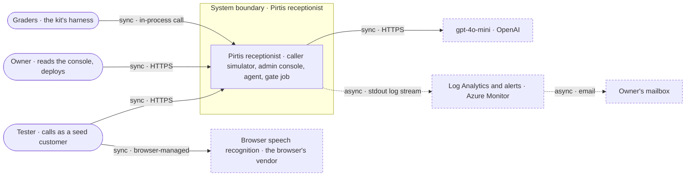
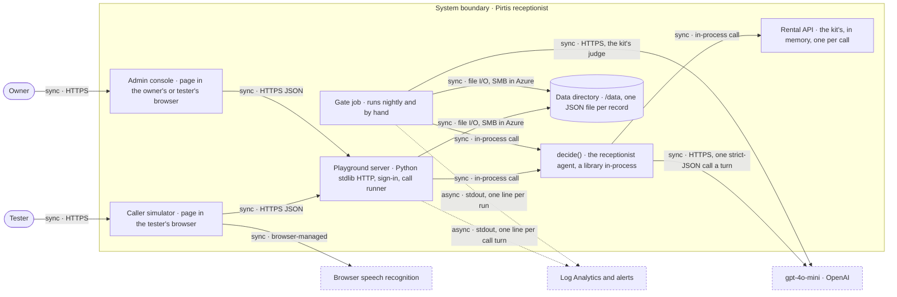

> Verified against `3e57ec9` on 2026-10-31.

# Containers

What runs, and what we don't control. Level 1 is the system as one box; level 2 opens
it. Where it runs (resource group, registry, identity) is in `deployment.md`; who does
what in order is in `sequences.md`; where personal data goes is in `data-flow.md`.

## Level 1 · context

The graders don't use the deployment: they run the kit's harness, which calls `decide()`
in their own process. Everything else is the deployed system.

## Level 2 · containers

| Container | What it does | Evidence |
|---|---|---|
| Caller simulator | Pick a seed customer or an unknown number; type, or hold to talk; the fogged booking card condenses as facts are heard; thumbs on every reply; scenario cards and the rating form | `python/pirtis/playground/static/caller.html`, `python/pirtis/playground/static/js/caller.js` |
| Admin console | Reliability (gate runs, the thermal view), Conversations, Traces, Feedback, Fleet, Human eval; all computed from content-free records except a stored call's trace | `python/pirtis/playground/static/admin.html`, `python/pirtis/playground/static/js/admin.js`, `python/pirtis/playground/analytics.py` |
| Playground server | The JSON API and the two pages; the sign-in (accounts we create, signed sessions); runs each call turn through `decide()` and the kit's handlers, saves the call after every turn | `python/pirtis/playground/server.py`, `python/pirtis/playground/auth.py`, `python/pirtis/playground/calls.py` |
| `decide()` | Turn gate (no model call), one strict-JSON understanding call, a deterministic policy that owns every rule and write, code-rendered speech, one telemetry line | `python/pirtis/agent/agent.py`, `python/pirtis/agent/turn.py`, `python/pirtis/agent/understand.py`, `python/pirtis/agent/policy.py`, `python/pirtis/agent/rules.py`, `python/pirtis/agent/speech.py` |
| Rental API | The kit's fixed API over an in-memory store, seeded per call from the fixtures' seed: units, availability, customers, bookings | `python/pirtis/api/memory.py`, `fixtures/seeds/base.json` |
| Gate job | The frozen gate in one process: the kit's Runner over the nightly suite, the extractor eval, a saved gate run, one summary line, pruning | `python/pirtis/ops/gate_job.py` |
| Data directory | Sessions, feedback, ratings, turn records, gate runs, calibrations; atomic writes, retention per kind | `python/pirtis/ops/store.py`, `python/pirtis/ops/model.py` |

## Outside the boundary

| Dependency | Vendor · region | Edge | If it is down | Fallback | Evidence |
|---|---|---|---|---|---|
| gpt-4o-mini | OpenAI API · [CONFIRM: processing region, US unless a data-residency project is set]. Azure OpenAI in an EU region instead via `LLM_BASE_URL` | sync · HTTPS | a turn that needs the model is put through to a person; an unreadable answer gets "could you say that again?"; the gate job fails with `llm_errors` above zero | turns the turn gate settles (still talking, silence, a request for a person) need no model; none for the rest | `python/pirtis/llm/client.py`, `python/pirtis/agent/agent.py` |
| Browser speech recognition | the browser's vendor (Chrome sends audio to Google's service; [CONFIRM: Safari and Edge]) · [CONFIRM: region] | sync · browser-managed | holding to talk does nothing useful | typing, always available | `python/pirtis/playground/static/js/caller.js` |
| Azure Files, hosting the data directory | Microsoft Azure · Germany West Central | sync · SMB | calls can't be saved or resumed; a gate run isn't saved | none | `deploy/terraform/main.tf` |
| Log Analytics, alerts, email | Microsoft Azure Monitor · Germany West Central | async · container stdout | no log queries and no alerts; calls go on | the admin console reads the data directory, not the logs | `deploy/terraform/monitoring.tf` |
| Container registry | Azure Container Registry · Germany West Central | sync · HTTPS image pull | a new revision or a job run can't start; the running app is unaffected | none | `deploy/terraform/main.tf` |

**Not built:**
- real telephony; the caller simulator stands in for the phone line
- streaming speech; a turn is one request
- a queue; every call turn is synchronous
- single sign-on; accounts are made by hand
