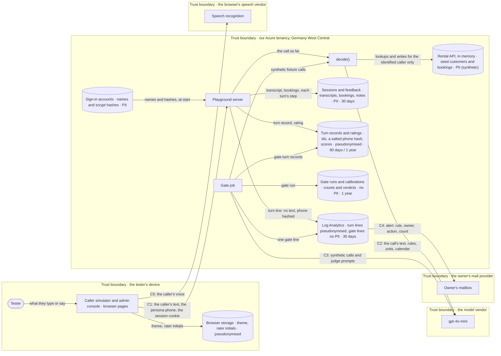

> Verified against `3e57ec9` on 2026-10-31.

# Data flow

Where personal data sits, and what happens to it just before it leaves. The customers
are made up (the fixtures' seed), and testers call as those customers. A tester's own
words and voice are still personal data, so they are labelled as such.

## Stores

| Store | Label | Kept | Evidence |
|---|---|---|---|
| Sessions | PII: what the tester typed or said, the bookings the call made, each turn's step | 30 days | `python/pirtis/ops/model.py`, `python/pirtis/playground/calls.py` |
| Feedback | PII: a transcript snapshot and the rater's note | 30 days | `python/pirtis/ops/model.py` |
| Turn records | pseudonymised: ids, a salted hash of the phone's digits, counts; no text | 90 days | `python/pirtis/agent/telemetry.py`, `python/pirtis/ops/model.py` |
| Human ratings | pseudonymised: the rater's initials, a session id, scores | 1 year | `python/pirtis/ops/model.py` |
| Gate runs, calibrations | no PII: fixture ids, verdicts, counts | 1 year | `python/pirtis/ops/model.py` |
| Sign-in accounts | PII: account names and scrypt hashes, a Container App secret | until removed | `python/pirtis/playground/auth.py`, `deploy/Makefile` |
| Rental API | PII in shape, synthetic in content: the seed's customers, phones and bookings; rebuilt per call, never saved | the call | `python/pirtis/api/memory.py`, `fixtures/seeds/base.json` |
| Log Analytics | pseudonymised: turn lines (phone hash, ids, no text); gate lines and access lines (method, path without its query, status) hold no personal data | 30 days | `python/pirtis/agent/telemetry.py`, `python/pirtis/playground/server.py`, `deploy/terraform/main.tf` |
| Browser storage | pseudonymised: the theme and the rater's initials, on the tester's own device | until cleared | `python/pirtis/playground/static/js/caller.js` |

Retention is applied by the gate job's prune on every run (`python/pirtis/ops/store.py`).

## Boundary crossings

| ID | From → To | Data | Before it crosses | Region | Transfer mechanism (GDPR Ch. V) | Retention | Evidence |
|---|---|---|---|---|---|---|---|
| C1 | caller simulator → playground server (and the replies back) | the caller's text (speech already turned to text in the browser), the persona's phone, the session cookie; back: our replies, the booking card, a stored call's trace for the console | TLS only (HTTPS, HSTS); a signed-in session is required; spending is capped per account and per day | Germany West Central (EU) | none needed (the receiving side is in the EEA) | sessions 30 days | `python/pirtis/playground/server.py`, `python/pirtis/playground/auth.py` |
| C2 | `decide()` → model vendor | the call so far as text: caller lines, our lines, short notes ("caller identified", the caller's own bookings by sauna and dates); the rules; the units; a 42-day calendar | nothing is redacted: the caller's words go as said, a name included if they spoke it. Never sent: the phone number, other customers' data, past bookings' site and car details | [CONFIRM: OpenAI's processing region; the US unless a data-residency project is configured] | [CONFIRM: OpenAI's DPA with SCCs, Art. 46(2)(c)]; none needed on Azure OpenAI in an EU region | [CONFIRM: OpenAI API retention; abuse monitoring up to 30 days unless zero retention is agreed] | `python/pirtis/agent/understand.py`, `python/pirtis/llm/client.py` |
| C3 | gate job → model vendor | synthetic fixture calls, and the kit's judge prompts with our replies | nothing: synthetic data only | as C2 | as C2 | as C2 | `python/pirtis/ops/gate_job.py`, `python/pirtis/harness/judge.py` |
| C4 | Azure Monitor → owner's mailbox | an alert: the rule's name, its owner-and-action text, a count, a link; the queries project only versions, case ids and counts | nothing: the rules read content-free lines | [CONFIRM: the mail provider's region] | [CONFIRM: depends on the mail provider] | [CONFIRM: the mailbox's retention] | `deploy/terraform/monitoring.tf` |
| C5 | caller simulator → the browser's speech vendor | the tester's voice, while they hold the mic button | nothing: the browser sends the audio itself (Chrome to Google's service) | [CONFIRM: the browser vendor's region] | [CONFIRM: the browser vendor's terms] | [CONFIRM: the browser vendor's retention] | `python/pirtis/playground/static/js/caller.js` |

**What this diagram says plainly:**
- **C2 leaves the EEA on the OpenAI path.** The data is synthetic customers plus whatever
  a tester types, which is why testers call as seed personas and never as themselves.
  Pointing `LLM_BASE_URL` at Azure OpenAI in an EU region keeps C2 inside the EEA.
- **C5 is the browser's doing,** not ours, and a tester avoids it by typing.

## Privacy threats (a LINDDUN pass over this diagram)

| Threat | Where | Finding | Handled by |
|---|---|---|---|
| Linking | turn records | the salted phone hash links one caller's turns across calls, by design for analytics | the salt is a secret; records expire after 90 days |
| Identifying | sessions, feedback | a tester can say their own name or details | seed personas only (scenario cards, the dial page's note); 30-day expiry |
| Data disclosure | C2, C5 | call text leaves the EEA to the model vendor; voice goes to the browser's vendor | synthetic personas; typing as an alternative; the EU model path. Recorded as a known limit (SPEC §12) |
| Unawareness and unintervenability | the caller simulator | the only notice is the dial page's line that calls are kept 30 days; a tester can't delete their own calls | the owner deletes on request (files on the share); a self-service delete is not built |
| Non-compliance | C2 | no DPA with the model vendor is recorded here | [CONFIRM: OpenAI DPA] |

**Not built:**
- redaction before C2 (names spoken by the caller go to the model as said)
- a self-service way for a tester to delete their calls
- a privacy notice beyond the dial page's line
