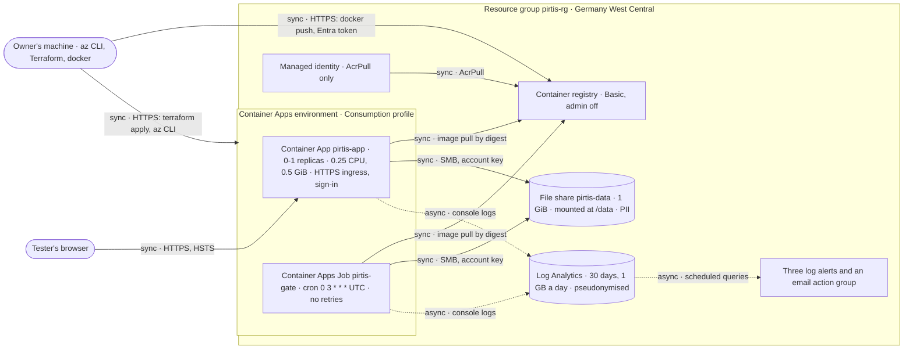

> Verified against `3e57ec9` on 2026-10-31.

# Deployment

Where the containers run. This view is about infrastructure; what talks to what is in
`containers.md`. Commands, costs and the bootstrap order are in `deploy/README.md`.

| Resource | Settings that matter | Evidence |
|---|---|---|
| Container App `pirtis-app` | 0 to 1 replicas; 0.25 CPU, 0.5 GiB; external ingress, HTTPS only; probes on `/api/health`; image by digest; secrets: model key, hash salt, session key, accounts | `deploy/terraform/main.tf` |
| Container Apps Job `pirtis-gate` | cron `0 3 * * *` UTC; 30 min timeout; no retries (a failed gate is read, never re-run); `gate-job --suites nightly` | `deploy/terraform/main.tf` |
| Container registry | Basic; admin account off; pulled only by the managed identity | `deploy/terraform/main.tf` |
| Managed identity | one role: AcrPull on the registry | `deploy/terraform/main.tf` |
| Storage account and share | LRS; TLS 1.2; HTTPS only; no public blob access; one 1 GiB share, linked to the environment with the account key | `deploy/terraform/main.tf`, `deploy/Makefile` |
| Log Analytics | 30 days; a 1 GB daily cap | `deploy/terraform/main.tf` |
| Alerts | gate regression, agent errors, slow turns; every 15 minutes over the last hour; email to the owner | `deploy/terraform/monitoring.tf` |
| The image | two stages, bases pinned by digest; uid 10001, read-only code; refuses to start without sign-in accounts | `deploy/Dockerfile`, `.dockerignore` |

**Secrets** are set by the az CLI, never written in these files: the model key, the hash
salt, the session key, the sign-in accounts, and the storage key for the share's link.
Terraform's state holds the storage keys and, once refreshed, the app's secrets. So the
state stays on the owner's machine, owner-only and out of git (`deploy/Makefile`).

**Not built:**
- remote, encrypted Terraform state
- Key Vault references for the secrets
- a managed-identity mount for the share (in preview; the account key is used today)
- private networking: the app has a public endpoint, behind its sign-in
- CI that builds, scans and deploys on every push
