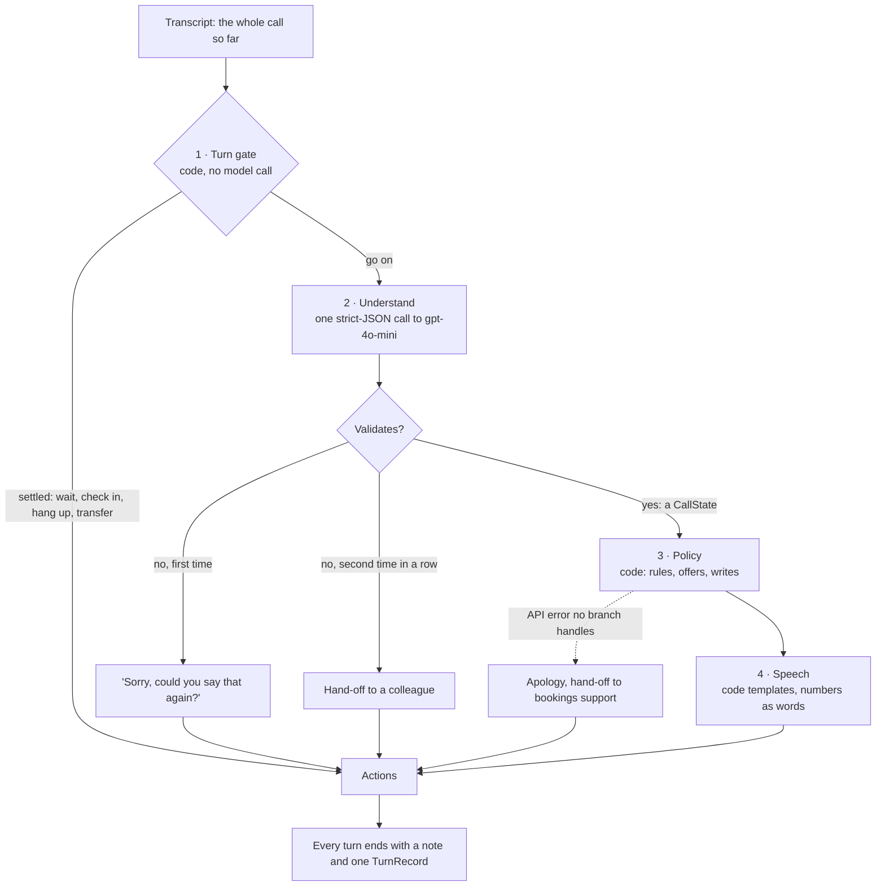
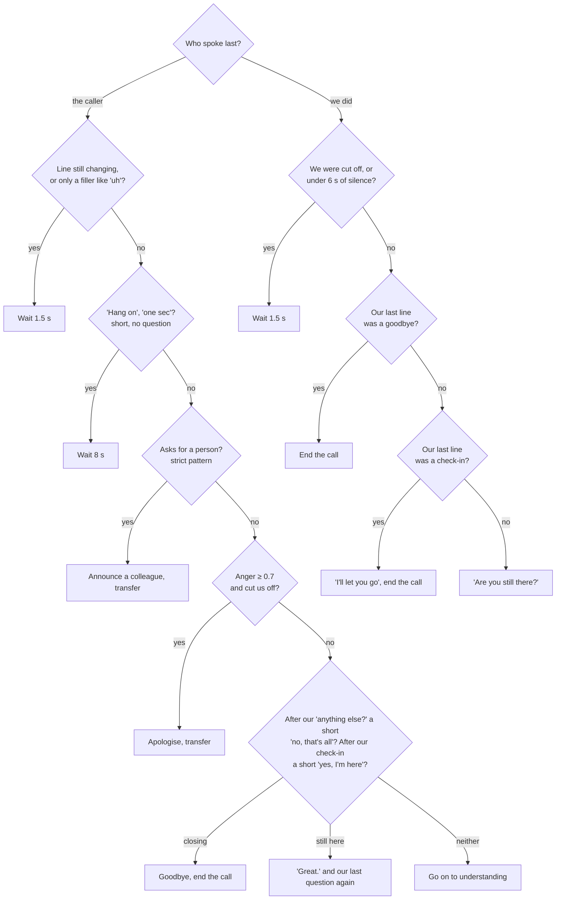
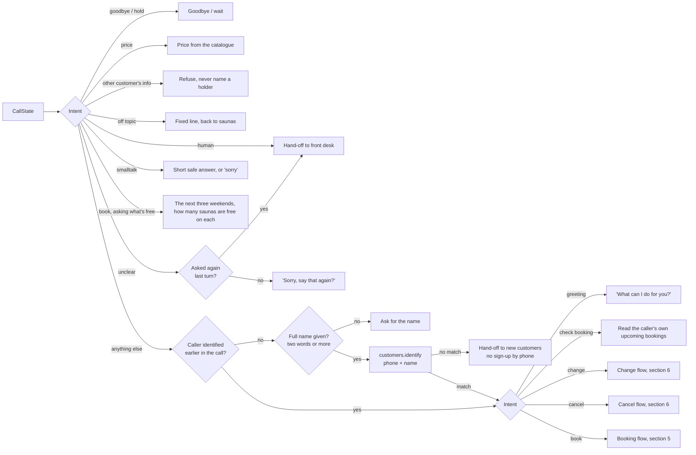
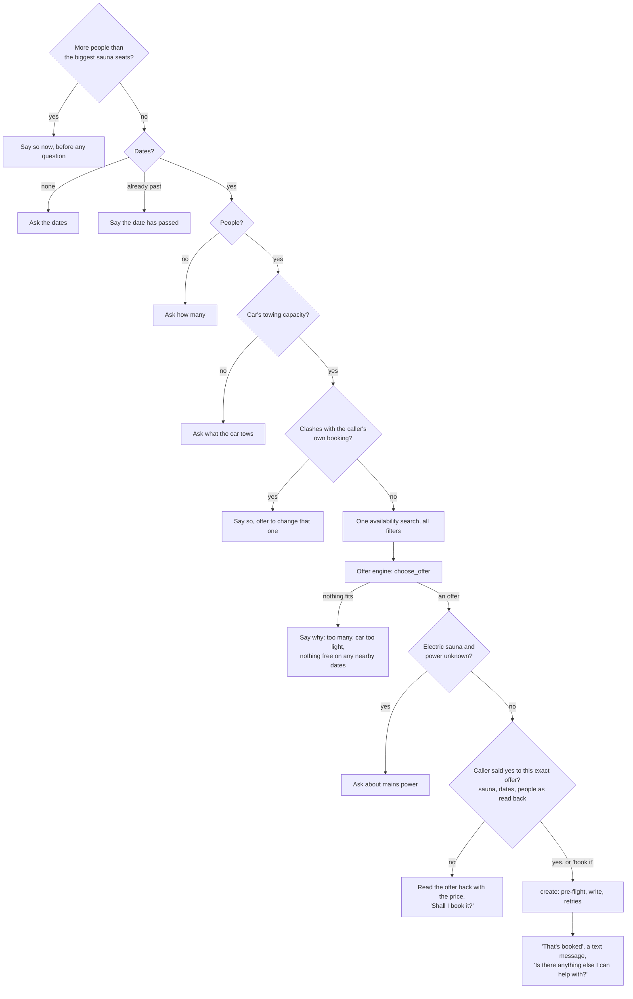
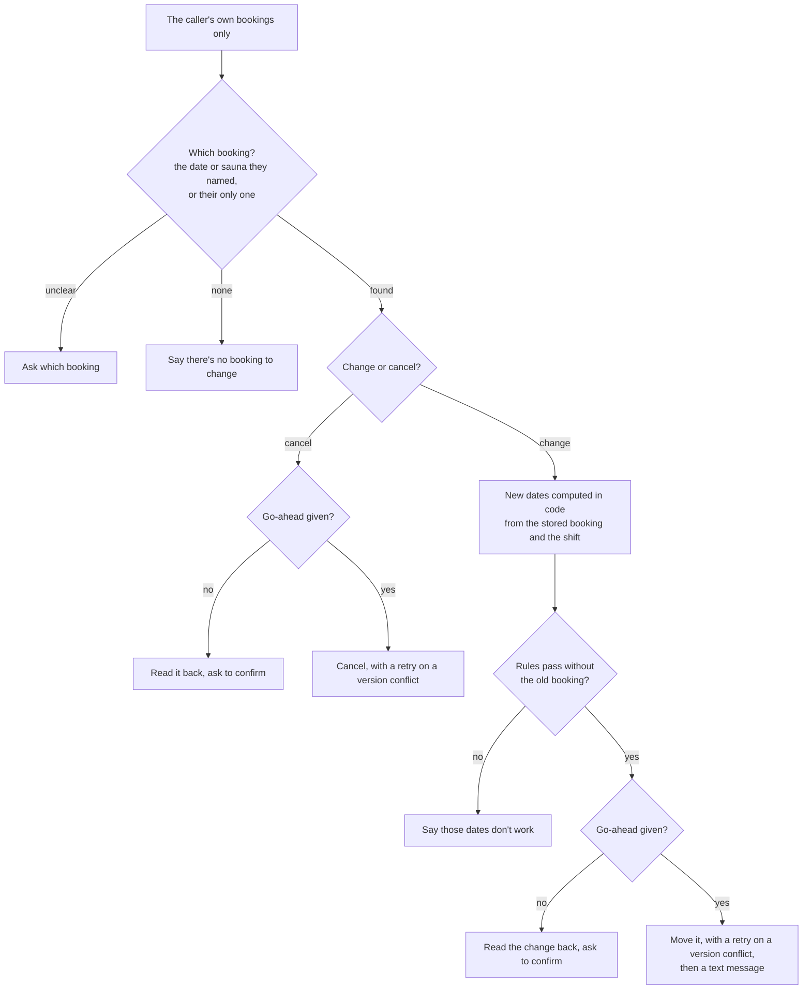

> Verified against `14e773f54eac`'s source on 2026-11-01.

# Logic flow

What the receptionist decides on one turn, and in what order. [`sequences.md`](sequences.md)
follows the two writes across the containers; this page follows the decisions inside
`decide()`. Every box names the code that does it; `D-nn` points to the
[decision log](../../SPEC.md#13-decision-log).

The agent is **stateless**: each turn it receives the whole call so far and rebuilds
what it knows from it. The kit calls `decide()` once per caller turn, so a conversation
of any length is this flow, run again on a longer transcript.

## How the receptionist remembers

**The transcript is the memory.** Nothing is stored between turns: each turn, `decide()`
reads the whole call so far and rebuilds three kinds of memory from it, the same way
every time. A memory rebuilt from the record can't drift or go stale, and a call survives
a restart by replaying its transcript.

| Memory | What it holds | Rebuilt by | Used for |
|---|---|---|---|
| **Facts** | name, dates, people, the car's limit, power, the sauna, consent, each with the caller's words behind it | the model reads them from both sides of the call; code checks each against the caller's own words (§3) | what to ask, what to offer, whether to book |
| **What has happened** | who the caller is; their bookings; what was booked, moved or cancelled in this call | the API calls recorded in the transcript (`identified_customer`, `own_bookings`) | never asking for a name twice; never reading anyone else's data |
| **Where the conversation is** | our last line: the question pending, the offer just read back (`last_offer`), a refusal already given, a check-in, a finished task | code, from our own lines (D-98) | picking the thread up after a pause, taking "book it" as a yes to the offer, not repeating a refusal, closing a call that's done |

The model sees the facts and the whole call; it never has to remember anything itself.
The cost is a prompt that grows with the call, about 2.1k tokens a turn for booking calls;
a much longer call would need older turns summarised (SPEC §12).

## 1 · One turn, end to end

| Step | Code | Model calls |
|---|---|---|
| 1 · Turn gate | `agent/turn.py` `gate()` | 0 |
| 2 · Understand | `agent/understand.py` `extract()` | 1 |
| 3 · Policy | `agent/policy.py` `next_step()` | 0 |
| 4 · Speech | `agent/speech.py` `render()`, then the `say` handler's digit guard in `agent/actions.py` | 0 |
| Wiring, fallbacks | `agent/agent.py` `decide()`, `_turn()`: never raises (D-19) | — |

## 2 · The turn gate

Runs before anything else, because speaking while the caller is still talking is the one
mistake a phone receptionist can't take back (D-04 to D-06).

The last two checks keep the thread of the call (D-98): they read our own last line, so
a short reply that adds nothing new is answered at once, with no model call.

A paraphrase the patterns miss ("could a human help me?") still reaches the model,
whose intents include `human`, `hold` and `goodbye`: a miss costs a model call, not a
wrong answer.

## 3 · Understanding

One call, temperature 0, with a strict JSON schema generated from the `CallState` class
(D-33, D-49). The prompt holds the rules of reading, the sauna catalogue from the API,
a 42-day calendar computed in code (D-16), and the call so far, both sides.

**The model fills, in this order:** a gist; the intent; the caller's name; dates; people;
each fact's quote **before** the fact (tow, sauna, heater reason, consent); power; the
consent flags last. Evidence before value is what fixed the asthma case (D-69).

**Code then checks what came back** (`CallState._facts_need_the_callers_words`):

| Fact | Counts only if | Otherwise | Decision |
|---|---|---|---|
| Towing capacity | its quote is in the caller's own words and carries a number | dropped: the tow is asked | D-08, D-54 |
| Sauna | its quote is the caller's and names or describes a sauna; code resolves the sauna from the quote if the model left it out | dropped | D-54, D-75 |
| People | always; a hedge ("eight, maybe nine") is raised to the higher number | — | D-79 |
| A "yes" to an offer | its quote is from the caller's latest turn, our last line asked to book, and the turn holds no price demand or instruction to the system | void: the offer is read back again | D-10, D-54, D-74 |
| Name | a name the caller asks about is not theirs | dropped | D-78 |
| Dates, numbers, the sauna id | a real date; 1–50 people; 100–20,000 kg; a sauna in the catalogue | unknown, so it is asked again | D-49 |
| The answer as a whole | valid JSON in the schema | "Sorry, could you say that again?"; twice in a row, a colleague | D-19 |

## 4 · The policy

`next_step()` turns the checked state into one decision. Some intents need nobody's data;
everything else waits for identification (D-07, D-11).

A refusal that would repeat the line we just said word for word closes the topic
instead: "I'm sorry, none of our saunas can take that many people, so I can't book this
one. Is there anything else I can help with?" (D-98).

## 5 · Booking: one question at a time, then an offer

`book()` asks for the **one** next missing fact (D-09), says a problem as soon as it is
known (D-68, D-71), and writes only on a yes to exactly what the caller heard (D-10, D-52).

**The offer engine** (`choose_offer()`, D-12, D-35):
1. Drop every sauna that breaks a hard limit: too small, too heavy for the car, electric
   without power. Hard limits are never overridden.
2. A heater preference **sorts**; it **filters** only when the caller gave a reason
   ("the smoke bothers me") or named that sauna as a must-have, and a must-have is never
   filtered out (D-69).
3. A booking touching a weekend is stretched to two days (D-13).
4. The sauna the caller asked for, on their dates, if the rules allow it. If its dates
   are taken: another sauna on those dates, or, if they insist on that one or nothing
   else fits, the same sauna moved in time.
5. Otherwise the smallest fitting sauna on their dates.
6. Otherwise the nearest dates that work for any fitting sauna, searching 0, +1, −1, +2,
   −2 … days, never before today.

Every candidate passes `violations()`, the copy of the API's write rules, so nothing is
offered that the API would reject (D-31).

**Writing** (`create()`): the rules run once more before the write. If something changed
since the offer, the new offer is read back and nothing is written. A 409 (someone took
the slot) means a second look and one more try, or the next best offer; a 500 means
checking whether the booking landed before trying once more (D-19). The paths are drawn
in [`sequences.md`](sequences.md).

## 6 · Changing or cancelling

The booking's own days, and its own turnaround day when the day beyond is free, count
as free when it moves (D-15).

## 7 · Speech

`render(decision, voice)` turns each decision into actions from code templates (D-17):
- **one question** per turn, short sentences, offers ending "Shall I book it?"
- **numbers, dates and euros as words**; the `say` handler turns any digit left into
  words, whatever wrote the line
- **things that aren't done are said outright** ("I can't look at your bookings until I
  know who's calling"), so no reply can be read two ways (D-51, D-87)
- a **calmer, slower voice** when the caller's latest turn sounds angry or upset
- a **text message** after a booking or a move; a **summary for the colleague** on every
  transfer

## Where the model's judgement ends

| Decided by the model | Decided by code |
|---|---|
| what the caller wants (the intent) | whether to answer at all this turn |
| what they said: name, dates, people, tow, sauna, heater, power, consent, with quotes | whether each of those facts counts |
| — | which question comes next |
| — | which sauna, which dates, what price |
| — | whether to write, and what |
| — | every word the receptionist says |

So a model mistake can cost an extra question or a "say that again", never a booking
that breaks a rule or a reply the code didn't write.
