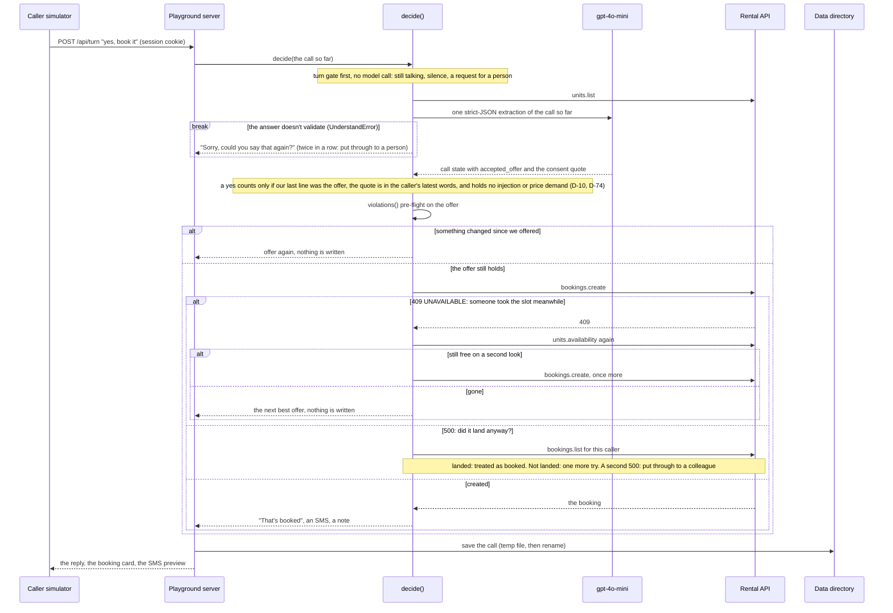
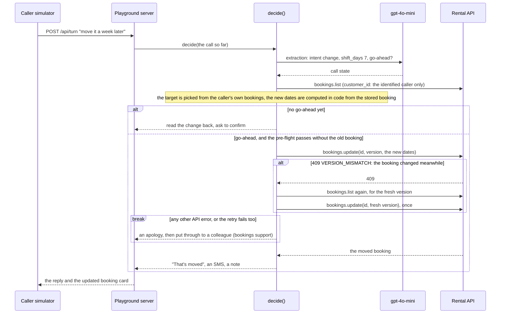

> Verified against `3e57ec9` on 2026-10-31.

# Sequences

The two paths that write something a customer relies on: a new booking, and a change
to one. The participants are the containers in `containers.md`.

## 1 · A booking, on the caller's yes to our read-back

The pre-flight `violations()` mirrors every rule the API enforces and is property-tested
against it (`python/pirtis/agent/rules.py`), so a 422 can't happen by construction. The
retries are in `create()` (`python/pirtis/agent/policy.py`); a failure no branch
handles becomes a hand-off to a person (`python/pirtis/agent/agent.py`).

## 2 · Moving or cancelling a booking

A cancel is the same path with `status: cancelled` as the change. The retry is
`update_with_retry()` in `python/pirtis/agent/policy.py`.

**Not built:** an idempotency key on writes. A double submit is safe today only because
one call is one session handled one turn at a time, and the 500 branch looks before
retrying.
