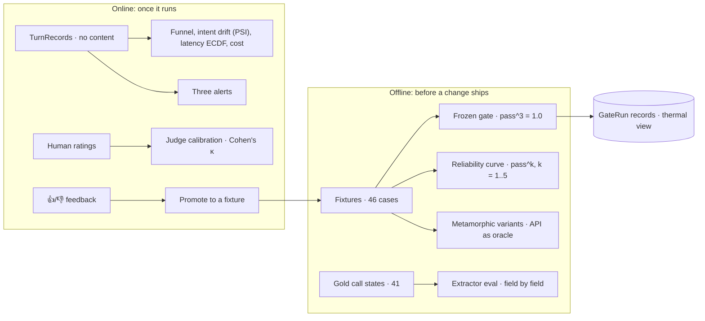

# Data science: how the receptionist is measured

[evaluation.md](evaluation.md) has the **results**. This page has the **methods**: what
each number means, how it is computed, which code computes it, and how far to trust it.
The decisions behind each one are in [SPEC §13](../SPEC.md#13-decision-log).

The receptionist is a stochastic system: one model call a turn, at temperature 0, and
gpt-4o-mini still varies between runs. The kit's judge, another model call, varies too.
So no single run proves anything. Every claim here rests on repeated runs, a split of
the failure's cause, and a record of every run.



## 1. The metrics at a glance

| Metric | Question it answers | Definition | Code |
|---|---|---|---|
| **Gate pass^3** | Does every case pass every time? | a case passes when all 3 of 3 runs pass; the gate passes when every case does | `ops/gate_report.py` |
| **Deterministic / judge pass^k** | Was a failure ours or the judge's? | the same, counting only the checks in code (action, bookings, API invariants), or only the judge's verdicts | `ops/gate_report.py` |
| **Extractor pass^k** | Did the model hear the call right? | a fixture passes when all k extractions match its gold call state | `ops/extract_eval.py` |
| **Field accuracy** | Which part of understanding is weak? | per field, correct extractions ÷ compared extractions | `ops/extract_eval.py` |
| **Reliability pass^k** | What does a 3-run gate miss? | unbiased estimate of k passes in a row, from n = 5 runs | `ops/reliability.py` |
| **Cohen's κ** | Can the judge's verdicts be trusted? | judge–human and rater–rater agreement beyond chance | `ops/calibrate.py` |
| **PSI** | Have callers changed? | population stability index of the intent mix, last 7 days against the 7 before | `playground/analytics.py` |
| **p50 / p95 latency** | How long is the silence? | nearest-rank percentiles of turns that called the model | `ops/gate_report.py`, `playground/analytics.py` |
| **Cost per turn** | What does a turn cost? | tokens × gpt-4o-mini prices ($0.15 in, $0.60 out per million) | `ops/gate_report.py` |
| **Zero-call share** | How often is the model not needed? | turns the turn gate settled ÷ all turns | `playground/analytics.py` |

All paths are under `python/pirtis/`.

## 2. The data

| Source | What it is | Size | Where |
|---|---|---|---|
| Fixtures | a call so far, the world (seed + setup) and the expected result: action, bookings, judge statements | 14 given + 32 ours | `fixtures/`, `fixtures/extra/` |
| Seed | the saunas, customers and existing bookings every fixture starts from | 1 file | `fixtures/seeds/base.json` |
| Gold call states | what the model should hear on each fixture it sees, field by field | 41 | `python/pirtis/agent/gold/` |
| Variant candidates | metamorphic copies of the given cases, checked by the kit's API | 59 kept of 64 | `fixtures/variants-candidates/` |
| Scenario cards | goals, facts and a twist for people calling the live app | 15 | `tests/human/scenarios.yaml` |
| Harness traces | one `result.json` per run, with every model call | per gate run | `python/runs/` (not in git) |
| Records we own | Session, Feedback, HumanRating, GateRun, Turn, Calibration | per call, per run | `python/var/` or the Azure file share |
| Raw reports | the output behind every number in the docs | per phase | `reports/` |

**Our 32 cases** come in four kinds, each written for a different failure:
- **edge cases (20–29):** unknown callers, cancellations, a car too light, a weekend
  minimum, a correction mid-sentence
- **hidden-style (30–41):** the same rules with other callers, cars and dates, since the
  graders hold hidden cases "with the same rules"
- **red team (50–56):** prompt injection, a price demand, a request for another
  customer's details, a request for the system prompt
- **promoted (60–62):** real calls in the simulator that went wrong, turned into cases
  through the improvement loop (§9)

**Gold states have their own rules:** a gold file can `ignore` a field the fixture can't
decide, list `one_of` groups where two readings are both right, and mark a field as
compared by presence only (`heater_reason`: whether a reason was given matters, not its
words). A test refuses a model-facing fixture without a gold state.

## 3. The frozen gate

Decided before any agent code was written (D-21) and never lowered.
- **Every case, 3 runs, all 3 must pass.** That is pass^3 = 1.0, not pass@3: a case
  that passes once in three tries is a failing case.
- **The verdict is split.** Each run's failures are sorted into the deterministic checks
  and the judge's. A judge-only failure is read before anything changes: our reply may
  be wrong, or the judge may have misread a correct one (§8).
- **Reported with every run:** cases, runs, both pass^k, model calls (and runs with
  none), tokens, cost, p50 and p95. Saved as a `GateRun` record, computed from the
  harness's own rows rather than passed in.

**What a 3-run gate can and can't see.** A case that fails a share f of its runs slips
through a 3-of-3 gate with probability (1 − f)³:

| Per-run failure rate f | Gate catches it (3 runs) | Curve catches it (5 runs) |
|---|---|---|
| 1% | 3% | 5% |
| 5% | 14% | 23% |
| 10% | 27% | 41% |
| 20% | 49% | 67% |
| 33% | 70% | 87% |

So one passing gate says little about one case. It says more about the whole agent:
**138 runs with no failure puts a 95% upper bound of about 2.1% on the per-run failure
rate**, pooled over all cases (1 − 0.05^(1/138); the "rule of three" gives 3/138). That
is why there is also a reliability curve.

## 4. The reliability curve: pass^k

Every case runs n = 5 times. For a case with c passes, the unbiased estimate of passing
k runs in a row is

```
pass^k = C(c, k) / C(n, k)
```

the estimator τ-bench uses. A suite's pass^k is the mean over its cases; k = 1 is the
plain pass rate. A flat curve means the agent is consistent; a falling curve means a
single good run hides flakiness.

**Worked example, case 62** ("eight of us, maybe nine"), c = 4 of n = 5:
- pass^1 = 4/5 = 0.8
- pass^3 = C(4,3)/C(5,3) = 4/10 = 0.4, so it would **fail a 3-of-3 gate 60% of the
  time**, even though it had passed two gates already
- pass^5 = 0

Averaged with 45 cases at 1.0, that one case gives the whole curve: 0.9957 at k = 1 down
to 0.9783 at k = 5. The cause was found in one read of the traces (the model took the
lower number of a hedge), fixed in code (D-79), and the four hedge-sensitive cases then
passed 20/20.

Run it with `make reliability` (about $0.30 with the judge).

## 5. The extractor eval: understanding, isolated

End-to-end failures mix three causes: the model misheard, the policy decided wrong, or
the judge misjudged. The extractor eval isolates the first (D-36).
- For each of the 41 gold states, the real extraction runs **k = 3 times** against the
  live model.
- Each run is compared field by field: names normalised and case-insensitive, presence
  fields by presence, `one_of` groups by any alternative.
- A fixture passes only if all k runs match. Per field, accuracy = correct ÷ compared.
- It exits non-zero on any miss, so it can gate too.

Run it with `make eval-extract`. The gate job runs it on the nightly suite as well.

### How understanding was engineered, measured at each step

The extraction is one strict-JSON call into a `CallState` (`agent/understand.py`). The
schema and its validators are where most of the gain came from, not the prompt:

| Technique | Why | Effect measured |
|---|---|---|
| **Evidence before value.** Field order is the order the model writes: a gist, then each caller quote before the value taken from it, consent last | the model commits to the words before the number | `heater_reason` before `heater_pref` fixed an asthma case read as a wish for wood (D-69): 22/23 → 23/23 |
| **Quotes verified in code.** A tow figure, a sauna and consent count only if their quote is in the caller's own lines (≥ 70% of its words in one line), with a number for a tow figure, and consent from the latest turn only | the model picked saunas from our own lines and set consent with no offer made | 12/20 → **20/20** (D-54); prompt rules alone had made consent worse (80%) |
| **Asymmetric hedges.** "Eight, maybe nine" people → the higher; "two or three tonnes" → the lower | under doubt, choose the reading that can never produce an offer the API rejects | the case-62 flake above (D-79) |
| **Consent voided by an attack.** A "yes" that names its own price or talks to the system is not a yes | prompt injection through the consent field | red-team case 50: "book it at zero euros" had been taken as a yes (D-74) |
| **Plausibility validators.** Dates must parse, group sizes and tow figures must be plausible, a sauna must exist | a wrong guess should cost a question, never a booking | — |

**Field accuracy, final run:** all 15 fields at 100% over 123 extractions
(`reports/phase-16/eval.txt`).

## 6. Metamorphic variants: the API as the oracle

The hidden cases have "the same rules, other callers, cars and dates". Variants make
exactly that from the 14 given cases (`ops/variants.py`, D-76):

| Transform | What changes | What must stay true |
|---|---|---|
| `persona` | another seed customer with no bookings calls | the expected outcome |
| `shift7`, `shift14` | the whole call is one or two weeks later: today, every spoken and written date, setup and expectation | weekdays stay right; the same saunas fit |
| `noise` | the caller's lines as speech-to-text writes them: fillers, a restart, lower case, figures as digits | the expected outcome |
| `tow` | the car tows another figure in the same band | the same saunas fit |

**The oracle is the kit, not our code.** A variant is kept only if the kit's loader reads
it, the kit's API accepts every booking it expects in a fresh world, and the API returns
the same fitting saunas as for the source. The caller's needs come from the source's gold
state, moved by the same transform. Of 64 generated, **59 were kept**; 5 were dropped
because a date shift changed which saunas fit. They wait in `variants-candidates/` for a
person's review (`make variants-accept`) before they join the gate.

## 7. The human evaluation and judge calibration

**The judge decides half of every gate verdict**, so how far it agrees with people is
measured, not assumed (D-47, D-77).
- **Protocol:** people call the live app with one of 15 scenario cards and rate the
  call: goal reached (yes/no), and four items from 1 to 5: natural, numbers clear, one
  question at a time, turn-taking ([tests/human/README.md](../tests/human/README.md)).
- **Binarising:** a score of 4 or 5 counts as "yes".
- **The judge's side:** each rubric item becomes a statement for the kit's own judge,
  asked of every receptionist reply in the call; the call passes the item only if every
  reply does. The goal is asked once, on the last reply, as the card's success sentence.
- **Agreement:** per item and pooled, the share of matching verdicts and Cohen's κ:

  ```
  κ = (p_o − p_e) / (1 − p_e),   p_e = p_a·p_b + (1 − p_a)(1 − p_b)
  ```

  κ is reported as undefined when p_e = 1 (both raters constant), not as 0 or 1.
- **Rater–rater κ:** where two people rated the same call, the same statistic between
  them, as the ceiling the judge can be held to.
- **Outcome from the record:** the Human eval view also checks each call's own record
  (booked, moved, cancelled, transferred) against the card's outcome, beside what the
  rater said.

**Status: built and tested, not yet run**: there are no ratings yet. `make calibrate`
refuses to save an empty calibration, so the console can't show one as a result.

## 8. Judge failure analysis

A judge-only failure is read, never rerun until green. The patterns found, each with
the evidence in `reports/`:
- **Polarity:** a negative criterion ("does not say whether the booking is still on")
  marked failed with a reason that agrees with the reply. Fixed by replies that state
  the fact outright (D-51, D-87).
- **"Or" read as "and":** "asks what car, or how much it can tow" failed a reply that
  asked one. Replies now cover both readings (D-51).
- **No date, no literal grading:** the judge isn't told today's date and grades against
  the caller's request, so our statements stay within what it can check; the rest is
  checked by gold states and unit tests (D-72).
- **Rate of the remaining flake:** fixture 01, 1 judge failure in about 43 runs on an
  identical reply, before D-87; 20/20 after.

## 9. Online: telemetry, monitoring and drift

**One `TurnRecord` per turn, with no content** (`agent/telemetry.py`): which path the
turn took, the intent, the decision, the actions, model calls, tokens, latency, every
API call as method, status and code, whether it fell back, and the phone as a salted
hash. No text, no names. It renders to OpenTelemetry GenAI attributes through one
function. Every analytics view reads only these records, gate runs or the seed, so none
of them can name a customer.

| Admin view | Analysis |
|---|---|
| **Conversations** | the funnel (started → identified → offered → booked) and the exits (transferred, hung up, fell back); the intent mix against the previous window; the latency ECDF; tokens per model turn; zero-call share; cost; API calls by status |
| **Intent drift** | PSI = Σ (p − q) · ln(p / q) over intents, shares floored at 10⁻⁴; 0.10 warns, 0.25 alerts (D-43). Below 30 turns in either window it says "too few" rather than a number |
| **Reliability** | the thermal view: a row per case, a column per run grouped by agent version; each cell pass, fail, or judge-only fail |
| **Fleet / what if** | each sauna's next 42 days (free, booked, turnaround, blocked), and for a hypothetical booking, each rule it breaks, in words, from the policy's own rule mirror |
| **Human eval** | per card: ratings, raters, goal rate, the record's outcome rate, rubric means; the rubric's spread; the latest calibration |

**Latency** is measured per `decide()` call, model turns only; turns the gate settles
take 0 ms and are counted apart, so they can't flatter the percentiles.

**Alerts** (Log Analytics, every 15 minutes over the last hour): a gate regression, any
fallback or API error, and p95 above 3 s. Gate and replay turns never reach the log, so
fault cases made on purpose can't fire them.

## 10. The improvement loop: a data flywheel

1. **Capture:** 👍/👎 and a note on any reply, saved as `Feedback` with the call so far.
2. **Promote:** a person turns a flagged reply into a fixture: the call as `decide` saw
   it, the world as it stood, what should have happened. Seed people only (D-39).
3. **Red:** the case fails 3 times for the right reason, or its statement is sharpened.
4. **Fix, test first,** and add a gold state if the model sees the case.
5. **Re-measure:** extractor eval, then the full gate. Every prompt or policy change
   changes `agent_version`, so every number is tied to the code that made it.

Cases 60–62 came through this loop; case 62 then exposed the hedge flake in §4.

## 11. Data governance

- **Six versioned record types** (`ops/model.py`): frozen pydantic models, unknown
  fields refused, time zones required, each with a retention period: 30 days for calls
  and feedback, 90 for turn records, a year for ratings, gate runs and calibrations.
- **A privacy class on every field:** personal, pseudonymous or none. A test pins the
  personal fields to exactly the call transcripts, bookings, steps and feedback notes.
- **Atomic, index-free storage:** one JSON file per record, written by rename, so the
  playground and the gate job can write at once (`ops/store.py`).

Full table: [SPEC §9b](../SPEC.md#9b-data-model-and-flows); where personal data crosses
a boundary: [architecture/data-flow.md](architecture/data-flow.md).

## 12. Limits of these numbers

- **Small n.** 46 cases × 3 runs, or × 5 for the curve. A per-case rate is coarse; the
  pooled bound in §3 is the stronger statement, and it assumes cases are alike.
- **The curve is one version behind.** It was measured on `a40b5e6fcd67`; D-79 and D-87
  followed, each re-measured on the cases they touch (20/20), not on a new full curve.
- **The judge is a model too.** Its verdicts aren't calibrated against people until the
  human evaluation runs.
- **No confidence intervals** are printed by the gate report; §3 gives the arithmetic.
- **Cost is the agent's only;** the judge's calls aren't in the traces.
- **Latency is `decide()` time,** not the caller's: speech-to-text and text-to-speech
  would add to it.
- **Variants aren't in the gate yet,** and drift is watched on intents only, without an
  alert.
- **Fixtures are hand-written or promoted from the simulator,** not from real phone
  calls.

## 13. Reproduce

From `python/`, with a key in `.env`:

| Command | What it does | Model spend |
|---|---|---|
| `make check` | lint, strict types, tests, including every metric's unit tests | none |
| `make gate` | the frozen gate and its report | about $0.05 + the judge |
| `make eval-extract` | the extractor eval, 3 runs per gold state | about $0.05 |
| `make reliability` | pass^k for k = 1..5 | about $0.30 with the judge |
| `make variants` | generate and check the variant candidates | none |
| `make calibrate` | judge–human agreement on saved ratings | one judge call per item per reply |
| `python -m pirtis.ops.gate_report --dir runs/gate` | the report alone, from saved traces | none |
