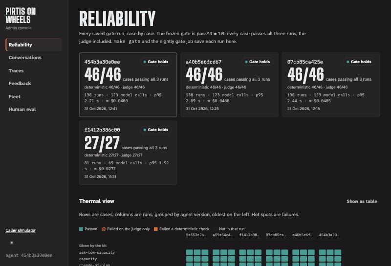
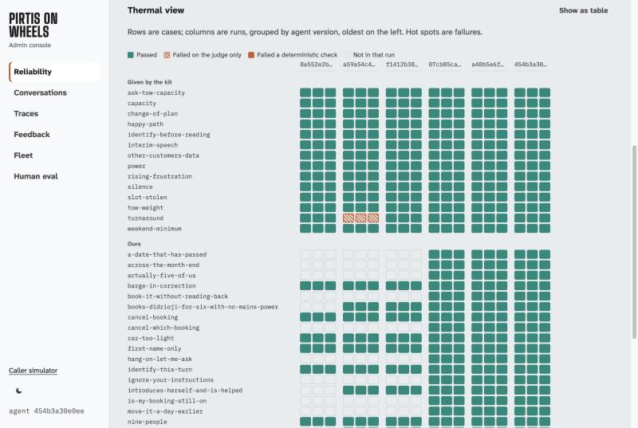

# Admin guide: the admin console

The admin console shows what the receptionist did, how reliable it is, and how to turn
what went wrong into a test case. It is at `/admin`, behind the same sign-in as the
caller simulator ([using-the-app.md](using-the-app.md)). Locally: `cd python && make
playground`, then <http://127.0.0.1:8000/admin>.

What every number means and how it is computed: [data-science.md](data-science.md).

| View | Answers | Reads |
|---|---|---|
| [Reliability](#reliability) | Does the agent pass every test case, every time? Which failed, and since which version? | saved gate runs |
| [Conversations](#conversations) | What do callers ask for, how far do calls get, how fast and how costly is it? Have callers changed? | turn records, with no words or names |
| [Traces](#traces) | What happened on one turn, step by step? | the simulator's calls |
| [Feedback](#feedback) | Which replies did people rate badly, and which should become test cases? | 👍/👎 from the simulator |
| [Fleet](#fleet) | Which saunas are free, and why would one not take a booking? | the seed calendar |
| [Human eval](#human-eval) | How do people rate the calls, and does the automatic judge agree with them? | scenario-card ratings |

The theme switch (☀ / ☾) changes between the dark *Soot* and the light *Steam* themes.
Every chart has a *Show as table* button.

## Reliability

**The version tiles**, newest first, one per saved gate run:
- **Gate holds / Gate fails:** every case passed all 3 runs, the judge included, or not.
- **The big number:** cases passing all runs, then the same split into deterministic
  checks (action, bookings, API rules) and the judge.
- **The kit's cases and ours, apart:** *Given by the kit* (the 14 the graders gave us)
  and *Written by us* (our 32), each with its own pass count. A red count shows which
  side failed.
- the extractor's score, when the run included it, then runs, model calls, p95 latency,
  cost and the failed cases.

**The thermal view:** a row per case, a column per run, grouped by agent version, oldest
on the left.
- **Rows come in families:** *Given by the kit* first, then *Written by us* by kind:
  edge cases (20–29), hidden-style (30–49), red team (50–59), promoted from calls (60+),
  and *Generated* (metamorphic variants) once they join the gate.
- **The filter** (*All cases*, *Given by the kit*, *Written by us*) shows one family.
- **Cells:** teal passed; hatched failed on the judge only; solid ember failed a
  deterministic check; empty means not in that run.
- **Click a cell** for the command that reproduces it with its full trace,
  `make trace ID=<case>`.

**When the gate fails:**
1. Find the hot cells, and the version where they started.
2. A **judge-only** failure: read the judge's reason in the trace before changing
   anything. The reply may be wrong, or the judge may have misread a right one
   ([data-science.md §8](data-science.md#8-judge-failure-analysis)). Never rerun until
   it passes.
3. A **deterministic** failure is the agent's: reproduce it, write a failing unit test,
   fix it, then `make gate` (SPEC §11).

## Conversations

Built from content-free turn records: no words, no names, the phone only as a salted
hash.
- **Window:** 7 or 30 days. **Source:** *Playground* (people calling), *Gate* (the test
  runs), or both.
- **The tiles:** turns, calls, the share **answered without the model** (waiting,
  silences, hand-offs), latency of model turns, cost.
- **From call to booking:** calls reaching each step (called, identified, offered,
  booked) and how the rest left: put through to a person, hung up, or fell back.
- **Intent mix and drift:** each intent's share now against the window before, with the
  PSI. Below 0.10 is stable, above 0.10 a warning, above 0.25 an alert; under 30 turns
  in either window it says there are too few to judge.
- **Latency:** the distribution of model turns; the slow-turns alert fires at a p95
  above 3 s.
- **API calls by status:** any 4xx or 5xx outside a deliberate test is worth a trace.

## Traces

One turn of a simulator call, left to right:
1. **Heard:** the transcript as `decide()` saw it.
2. **Understood:** the call state the agent accepted, **with the caller's quoted words**
   behind each fact. Code drops a fact whose quote isn't in the caller's own words, so
   what shows here is what the policy actually used.
3. **Decided:** the policy's decision (offer, ask, book, transfer…).
4. **API:** the calls made and their status.
5. **Said:** the reply, and any text message.

**Flag this turn** sends it to the Feedback queue, the same as a 👎 in the simulator.

## Feedback

Rated lines, newest first, each with its note and its trace. Nothing becomes a test case
on its own.

**To turn a bad reply into a test case:**
1. Open the line and its trace. Decide whether it's a real defect; a wish that
   contradicts a voice rule isn't. Leave it in the queue if not.
2. Press **Save as test case** and fill the form:
   - **What should the receptionist have done?** say, wait, transfer or end the call
   - **A booking should be made or changed on this turn**, if so
   - **What must the reply say?** One statement per line, worded positively ("The reply
     says no sauna seats nine"), since the judge misreads negatives
   - **Why this case** (optional)
   - **The confirmation** that everyone in the call is a seed customer or made up
3. Locally the case is written to `fixtures/extra/NN_<title>.yaml` (from 60). In the
   cloud the file **downloads**: put it in `fixtures/extra/` in the repo yourself.
4. Then, in `python/`:
   - **Red:** it must fail for the right reason first:
     `uv run harness --fixtures ../fixtures/extra --id <case> --runs 3 --need 3 -v`
   - **Fix** with a failing unit test first; add a gold state in `pirtis/agent/gold/` if
     the model sees the case
   - **Green:** `make eval-extract`, then `make gate`
   - commit and deploy. The case now shows in Reliability under *Promoted from calls*.

## Fleet

- **Calendar:** every sauna's next 42 days, as each simulated call starts from them:
  free, booked, a turnaround day, or in for service. It never says who booked.
- **What if?** Enter people, towing capacity, power and dates. Each sauna says whether it
  would take the booking and, if not, why, in words. The answers come from the same rule
  mirror the receptionist checks before every write.

## Human eval

Empty until testers rate calls with scenario cards ([guide-caller.md
§4](guide-caller.md#4-scenario-cards-the-human-evaluation)).
- **By card:** ratings and raters, the share of calls where people said the goal was
  reached, the share where the call's own record reached the card's outcome, and the
  mean of each rubric item.
- **Rubric spread:** mean, lowest and highest for each item.
- **Calibration:** after `make calibrate`, how often the kit's judge agrees with people
  per item, Cohen's κ, and κ between testers who rated the same call. A low κ means the
  judge's verdicts on that item shouldn't be trusted alone.
- **Notes:** what testers wrote, newest first.

## Owner tasks

Run from `deploy/` on the machine you deploy from, signed in with `az login`
([deploy/README.md](../deploy/README.md)).

| To… | Run | Notes |
|---|---|---|
| add an account | `make user NAME=ana` | the password goes to `deploy/.passwords/ana.txt` (mode 600): hand it over privately, then delete the file |
| add an account made elsewhere | append its `name:salt:hash` line to `deploy/.users`, then `make users` | `make users` sends **every** line in `.users`, replacing the app's list |
| remove an account | `make user-remove NAME=ana` | its sessions end at once |
| sign everyone out | `make rotate-session` | |
| get the address | `make url` | |
| watch the live console | `make logs` | |
| restart the app | `make restart` | also clears a sign-in lockout |
| run the gate now | `make gate-now` | the result appears in Reliability |
| calibrate the judge | `make calibrate` | needs human ratings first |
| test the alert path | `make alert-test` | fires the gate-regression alert without spending tokens |
| ship a change | `make image`, then `make deploy` | the deploy refuses a version without a passing gate |

**Alerts** email the owner: a gate regression, agent errors (any fallback or API error)
and slow turns (p95 above 3 s), each evaluated every 15 minutes over the last hour.
