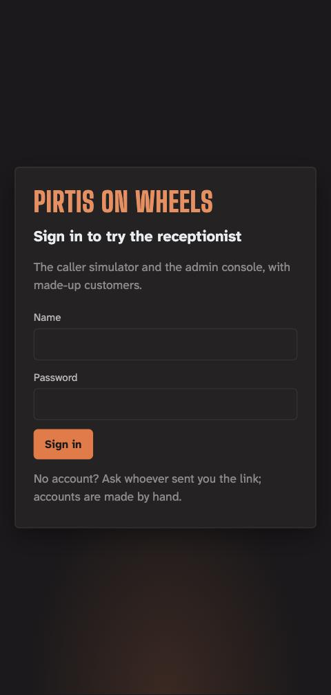
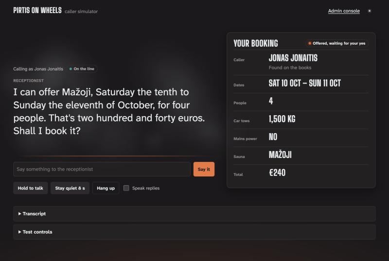
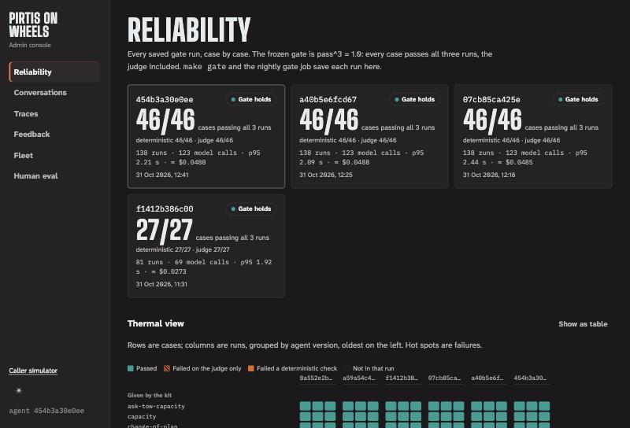

# Using the app

The receptionist, live, with made-up customers: a **caller simulator** to ring it, and an
**admin console** to see what it did.

**Open it:** <https://pirtis-app.bravegrass-b863ec32.germanywestcentral.azurecontainerapps.io>

The first visit after a quiet spell takes 40–50 seconds while the app wakes up. After
that it answers at once.



## 1. Sign in

1. Enter the **name** and **password** you were given. Accounts are made by hand. No
   account? Ask whoever sent you the link.
2. You land on the caller simulator, or on the page you opened the link for.
3. **Sign out** is at the top right (the admin console has it in the sidebar). A session
   lasts 12 hours.

After five wrong passwords, sign-in pauses for 15 minutes from your network.

## 2. Ring the receptionist



1. **Choose who's calling:**
   - a seed customer (Jonas, Tomas, Eglė or Rasa), who is on the books
   - or **Unknown number**, to be a new caller
2. **Speak or type.**
   - **Type:** write in the box and press *Say it*. This always works.
   - **Hold to talk:** works in Chrome, Edge and Safari, not Firefox. Your browser sends
     your voice to its own speech service, so type if you'd rather not.
   - **Replies are spoken aloud;** untick *Speak replies* to silence them.
3. **Watch the booking card.** Each detail comes out of the fog as the receptionist
   hears it:
   - the dates, the number of people, the car's towing limit, power and the sauna
   - hover over a detail to see the words it came from
   - after a booking, a text-message preview appears
4. **Rate any reply** with 👍 or 👎 and a note. The admin console's Feedback view
   collects them.
5. **Hang up** when you're done.

**Things worth trying:**
- a booking from start to finish: say who you are, then the dates, the number of
  people, and what your car can tow
- ten people (no sauna seats that many)
- a car that tows 700 kg
- "just book it" before anything was offered
- asking who has booked a sauna
- asking for a person

**Test controls** (the drawer under the call):

| Control | What it does |
|---|---|
| How angry you sound | sets your next line's anger, 0 to 1 |
| Cut in | your next line interrupts the receptionist's last one |
| Stay quiet 8 s | a silence: the receptionist checks in, then ends the call |
| Replay a fixture | runs one of the test cases through the real harness, with its verdicts |

## 3. Test with a scenario card (the human evaluation)

1. Under *Test with a scenario card*, pick a card and press **Call with this card**. It
   gives you a customer, a goal, what you know and one twist.
2. Make the call. Stay in the role: use only the card's details, never your own.
3. When the call ends, press **Rate this call** and fill in the five questions:
   - was the goal reached?
   - did it sound natural?
   - were the numbers and dates clear?
   - did it ask one question at a time?
   - did it handle silences and interruptions?

   Add your initials and a note if anything stood out.
4. Do the next card.

The full protocol is in [`tests/human/README.md`](../tests/human/README.md).

## 4. Look around the admin console



Open **Admin console** from the top bar.

| View | What it shows |
|---|---|
| Reliability | every saved gate run, and the thermal view: rows are test cases, columns are runs; hot cells are failures (click one for its trace) |
| Conversations | from content-free turn records: the funnel from call to booking, intents, latency, tokens, API errors; *Playground* for calls, *Gate* for the nightly job |
| Traces | one turn at a time: what was said, what the model heard (with the quoted evidence), the decision, the API calls, the reply |
| Feedback | the 👍/👎 queue; *Save as test case* turns a rated reply into a fixture (in the cloud, the file downloads) |
| Fleet | every sauna's next 42 days, without saying who booked them; *what if* explains why a sauna fits or doesn't |
| Human eval | the scenario cards' ratings, and how far the automatic judge agrees with people |

The theme switch (☀ / ☾) changes between the dark *Soot* and the light *Steam* themes.

## Limits you may meet

- **"Too many requests this minute"**: wait a few seconds. Each account has its own
  per-minute allowance.
- **"Today's budget for model calls is used up"**: a shared daily cap, reset at
  midnight UTC.
- **Privacy:** calls are kept 30 days so they can be reviewed, then deleted. The
  customers are made up; please don't type your own details.

## For the owner

Run these from `deploy/` (see [`deploy/README.md`](../deploy/README.md)).

Add an account. Its password is written to `deploy/.passwords/<name>.txt`; hand it over
privately, then delete the file:

```bash
make user NAME=ana
```

Remove an account; its sessions end at once:

```bash
make user-remove NAME=ana
```

Sign everyone out:

```bash
make rotate-session
```

Print the app's address:

```bash
make url
```
